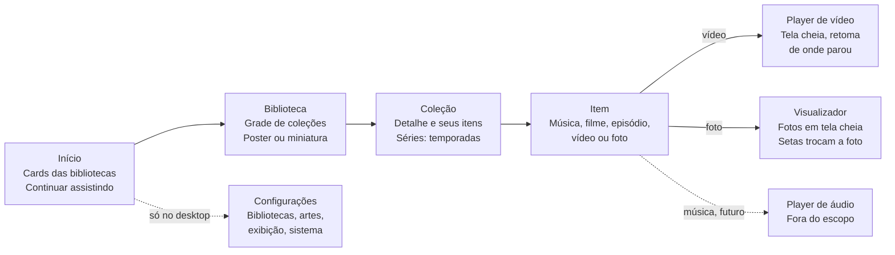
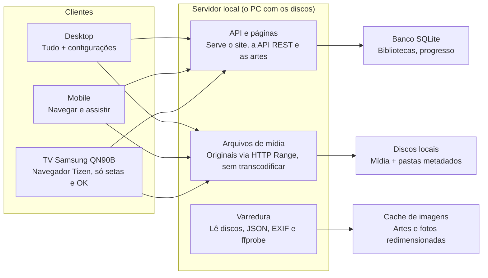

# Documentação — Central de Mídia Local

Atualizado em 16/10/2026

## Visão geral

O site é uma central de mídia pessoal que organiza músicas, filmes, séries, vídeos e fotos guardados nos meus discos locais e os apresenta em três interfaces: desktop, mobile e TV. Nada depende de nuvem: o conteúdo, os metadados e as artes ficam na minha máquina.

Princípios:

- **Uma hierarquia só:** Início → Biblioteca → Coleção → Item, igual em todas as plataformas.
- **Toda coleção tem três artes:** poster vertical, miniatura horizontal e capa de fundo; eu escolho se a grade mostra poster ou miniatura.
- **Desktop administra, TV assiste:** todas as configurações ficam no desktop; a TV só navega e reproduz, operada por setas.
- **Mobile consulta e reproduz:** mesmo conteúdo do desktop, com ajustes leves (modo de exibição, ordenação).
- **Só local, só eu:** acesso apenas pela rede de casa, por um único usuário, sem login nem perfis.
- **Metadados só locais:** tudo vem de arquivos JSON nas pastas; nenhuma busca online.
- **Sem transcodificação:** os arquivos são entregues como estão e tocados direto pelo navegador.
- **Foco em Fotos:** a biblioteca de Fotos é a primeira a ser mapeada e construída; Músicas é a segunda, já com leitura de pastas e player.
- **Identidade CAPRA:** fundo escuro, superfícies discretas e um único acento (Ciano), sem brilho.

## Decisões tomadas

| Tema | Decisão |
| --- | --- |
| Acesso | Apenas na rede local, apenas por mim (um usuário, sem perfis) |
| TV | Samsung QN90B, sistema Tizen, usando o navegador próprio da TV |
| Metadados | Apenas locais, em arquivos JSON; sem TMDb ou outra fonte online |
| Reprodução | Sem transcodificação; o arquivo original é enviado ao navegador |
| Formatos de vídeo | mp4 e mkv ficam como estão; os ts serão convertidos para mp4 antes de entrar na biblioteca; mkv que não tocar num aparelho fica marcado como "não suportado" nele |
| Bibliotecas | Músicas, Filmes, Séries, Vídeos e Fotos |
| Foco atual | Biblioteca de Fotos |
| Músicas | Leitura de pastas com player de áudio (ver Biblioteca de Músicas) |
| Níveis das fotos | Sempre 1, 2 ou 3; cada foto mostra seu nível; o álbum tem filtro e ordenação por nível |
| Tags | Editáveis por coleção e em massa, selecionando várias coleções na biblioteca |
| Criação da biblioteca de Fotos | Defino um caminho; cada subpasta dele vira um álbum |
| Clique na foto | Abre a foto expandida em tela cheia, sobre a grade, sem trocar de página |
| Pesquisa na biblioteca de Fotos | Por tags dos álbuns, combinando várias tags |
| Contagem por nível | O cabeçalho do álbum e o filtro mostram quantas fotos há em cada nível |
| Álbum oculto | Um álbum pode ser ocultado; só aparece no desktop com "Mostrar ocultos" ligado |
| Tags por foto | Guardadas em `metadados/fotos.json` de cada álbum; a foto herda as tags do álbum na pesquisa |
| Escolha de tags | Ao adicionar uma tag, as já existentes aparecem para só selecionar; digitar filtra a lista ou cria uma nova |
| Estilo visual | Manual de marca CAPRA v1.6, área Plataforma (acento Ciano, neutro preto), logo filha CR |

## Modelo de conteúdo

O conteúdo tem três níveis: **Biblioteca** (um tipo de mídia apontando para pastas nos discos), **Coleção** (um agrupamento dentro da biblioteca) e **Item** (o arquivo ou conjunto de arquivos reproduzível).

| Biblioteca | O que é uma coleção | O que é um item | Subníveis |
| --- | --- | --- | --- |
| Fotos | Um álbum (cada subpasta do caminho escolhido) | Foto | Nivel_1, Nivel_2, Nivel_3 dentro do álbum |
| Músicas | Ver Biblioteca de Músicas | — | — |
| Filmes | Um filme, ou uma saga (ex.: trilogia) | Arquivo de vídeo do filme | Saga → filmes |
| Séries | Uma série | Episódio | Série → temporada → episódio |
| Vídeos | Uma pasta ou tema (viagens, eventos, canais) | Arquivo de vídeo | Opcional: subpastas |

Campos comuns a toda coleção:

- Título, título de ordenação e descrição
- Poster vertical (2:3), miniatura horizontal (16:9) e capa de fundo horizontal (16:9)
- Ano, gêneros e tags
- Caminho(s) de origem no disco
- Data de adição e de última modificação

Campos por item: caminho do arquivo, duração, resolução, codecs, faixas de áudio e legenda, progresso assistido e marca de visto. Fotos guardam também data de captura (EXIF), câmera, orientação e o nível (1, 2 ou 3) quando estão numa subpasta de nível.

## Biblioteca de Fotos (primeira fase)

Para criar uma biblioteca de Fotos, eu defino o caminho de uma pasta no disco; cada subpasta desse caminho vira um álbum (coleção). Cada álbum tem uma pasta `metadados` com as artes e o JSON de informações, e as fotos ficam separadas em subpastas de nível.

### Criação da biblioteca

1. No desktop, em Configurações → Bibliotecas, clico em **Nova biblioteca** e escolho o tipo **Fotos**.
2. Dou um nome à biblioteca (ex.: "Fotos da família") e escolho o caminho pelo navegador de pastas (ex.: `F:\Fotos\`).
3. Antes de salvar, uma prévia mostra as subpastas encontradas, que serão os álbuns, e os avisos (pastas fora do padrão, álbuns sem `metadados`).
4. Ao salvar, o servidor faz a primeira varredura e a biblioteca aparece no Início.

- Posso ter mais de uma biblioteca de Fotos, cada uma com seu caminho.
- Trocar o caminho depois refaz a varredura; álbuns que somem do caminho ficam marcados como indisponíveis, sem apagar tags e metadados do banco.
- Subpastas novas criadas no caminho viram álbuns na próxima varredura (ou na hora, se o monitoramento de pastas estiver ligado).

```
F:\Fotos\                         ← caminho selecionado na interface
  Viagem Nordeste\                ← álbum = coleção
    metadados\
      poster.jpg                  ← poster vertical (2:3)
      miniatura.jpg               ← miniatura horizontal (16:9)
      capa.jpg                    ← capa de fundo horizontal (16:9)
      colecao.json                ← título, tags e demais metadados
    Nivel_1\
      IMG_0001.jpg
    Nivel_2\
      IMG_0042.jpg
    Nivel_3\
      IMG_0107.jpg
  Aniversario 2025\
    metadados\
    Nivel_1\
    ...
```

Regras:

- O caminho é escolhido nas configurações do desktop, por um navegador de pastas fornecido pelo servidor (o navegador web não consegue ler caminhos do disco sozinho).
- Cada subpasta direta do caminho é um álbum; o nome da pasta é o título padrão, substituído pelo `titulo` do JSON se existir.
- A pasta `metadados` não é exibida como fotos; ela só fornece artes e JSON.
- Os níveis são sempre três: fotos dentro de `Nivel_1`, `Nivel_2` e `Nivel_3` recebem o nível correspondente; o número vem do nome da pasta.
- Qualquer outra subpasta do álbum (ex.: `Nivel_4`, `Extras`) é ignorada e gera um aviso na varredura.
- Fotos soltas na raiz do álbum (se houver) aparecem sem nível.
- Os nomes de arquivo `poster.jpg`, `miniatura.jpg`, `capa.jpg` e `colecao.json` são a proposta inicial e podem ser ajustados.

Formato proposto do `colecao.json` (os campos além das tags ainda serão definidos):

```json
{
  "titulo": "Viagem Nordeste",
  "descricao": "Férias de julho",
  "ano": 2025,
  "tags": ["praia", "família", "nordeste"],
  "oculto": false
}
```

`oculto` é opcional; se faltar, o álbum é visível (ver Álbum oculto).

### Selo de nível nas fotos

Dentro do álbum, cada foto de uma subpasta de nível mostra um selo no canto superior direito com o número do nível e uma estrela (ex.: `★ 2`).

- Posição: canto superior direito do card, com 8 px de margem.
- Visual: fundo escuro semitransparente, texto e estrela claros, cantos arredondados; legível sobre fotos claras ou escuras.
- Aparece na grade do álbum em desktop, mobile e TV; na TV o selo é maior, na mesma escala do resto da interface.
- No visualizador em tela cheia, o selo aparece no mesmo canto.

### Filtro e ordenação por nível

- **Filtro:** Todos, Nível 1, Nível 2, Nível 3; mostra só as fotos do nível escolhido. Os botões são `Todos`, `★ Nível 1`, `★ Nível 2`, `★ Nível 3` e, se houver fotos soltas, `Sem nível`. A quantidade de fotos aparece num selo arredondado e cinza ao lado do nome, para não ser lida como outro nível (ex.: `Todos [128] · ★ Nível 1 [40] · ★ Nível 2 [60]`); um nível sem fotos aparece desativado.
- **Ordenação:** por nível (crescente ou decrescente), além de data de captura e nome.
- Disponíveis em desktop, mobile e TV; na TV ficam numa fileira de botões acima da grade, navegável por setas.
- O slide e o botão Aleatório respeitam o filtro ativo.

### Página do álbum

A página do álbum tem um cabeçalho com a capa ao fundo, o poster à esquerda e as informações ao lado, seguido da grade de fotos.

```
┌───────────────────────────────────────────────────────┐
│  capa.jpg escurecida ao fundo                     [⚙] │
│  ┌────────┐                                           │
│  │        │  Viagem Nordeste                          │
│  │ poster │  2025 · 128 fotos                         │
│  │  2:3   │  ★1 40 · ★2 60 · ★3 28                    │
│  │        │  praia · família · nordeste               │
│  │        │  Férias de julho                          │
│  └────────┘  [Aleatório]  [Slides ▾]                  │
│ ░░░░ fim da capa mesclado com o fundo escuro ░░░░░░░░ │
├───────────────────────────────────────────────────────┤
│  Filtro: Todos 128 ★1 40 ★2 60 ★3 28  Ordenar: nível ▾│
│  ┌──────★1┐ ┌──────★2┐ ┌──────★1┐ ┌──────★3┐          │
│  │  foto  │ │  foto  │ │  foto  │ │  foto  │          │
│  └────────┘ └────────┘ └────────┘ └────────┘          │
└───────────────────────────────────────────────────────┘
```

- **Capa de fundo:** a `capa.jpg` ocupa toda a largura do cabeçalho, escurecida (ex.: camada preta a 55–65%), e a parte de baixo se mescla em degradê com o fundo escuro da página, escondendo o fim da imagem horizontal.
- **Poster:** no canto superior esquerdo, sobre a capa, em proporção 2:3.
- **Informações:** ao lado do poster, vindas do `colecao.json`, nesta ordem: título, ano e quantidade de fotos, contagem por nível, descrição, tags (links que abrem a pesquisa de álbuns pela tag, só quando o álbum tem tags) e demais campos de texto ou número. Ficam de fora o que já aparece em outro lugar ou é interno: `titulo`, `tags`, `oculto`, `descricao`, `ano`, `poster`, `capa`, `miniatura`, `id` e `atualizado_em`.
- **Contagem por nível:** abaixo do total, uma linha com a quantidade de fotos de cada nível (`★1 40 · ★2 60 · ★3 28`), com a estrela em `--accent` e a quantidade no mesmo selo cinza do filtro. Clicar num nível aplica o filtro correspondente na grade. Fotos soltas na raiz do álbum entram no total, mas não em nenhum nível; se existirem, aparece também `sem nível` com a quantidade. A contagem vem da varredura e é guardada no banco, sem recontar as pastas a cada abertura.
- **Botões de ação:** Aleatório (ícone de dado) e Slides (ícone de play, que abre o menu Sequência / Aleatório), logo abaixo das informações. Ambos são botões redondos na cor de acento, com `title` e nome acessível "Aleatório" e "Slides". O menu abre à direita do botão no álbum e à esquerda na biblioteca, onde o botão fica na borda da tela. O cabeçalho do álbum não corta o menu: a capa de fundo desfocada é contida pelo próprio `clip-path`, e não por `overflow: hidden`.
- **Botão de configuração (⚙):** no canto superior direito, só no desktop; abre a edição do álbum (ver abaixo).
- No mobile, o poster fica menor e as informações descem para baixo dele; na TV, o primeiro foco da página é o botão Slides.

### Aleatório e Slides

Os dois botões existem na galeria de Fotos (tela da biblioteca, valendo para todos os álbuns) e dentro de cada álbum (valendo só para aquele álbum).

- **Aleatório:** sorteia uma foto e, em vez de abri-la na hora, mostra o **sorteio orbital** em tela cheia; ao parar na foto sorteada e esperar um instante, abre a foto. Dentro do visualizador, um novo sorteio continua instantâneo, pelo mesmo botão (ou tecla OK na TV). A TV ainda não tem sorteio orbital.
  - **Na biblioteca (busca de álbuns):** duas etapas. Primeiro giram os álbuns (com o poster ou a miniatura) e param no álbum sorteado; após 0,9 s, giram as fotos desse álbum; ao parar na foto e após 0,9 s, abre a foto no álbum. Na busca por fotos há só a etapa de fotos, e a foto abre no visualizador.
  - **No álbum:** só a etapa de fotos, entre as fotos visíveis com o filtro e a ordenação ativos.
  - **Como funciona:** a foto vencedora é sorteada antes do giro (o sorteio é por foto, então álbuns com mais fotos têm mais chance); a animação só encena o resultado. Até 8 vagas giram numa órbita em perspectiva em volta do núcleo, 1,5 volta em 2,4 s com a curva `ease-enter` da CAPRA, e param com o vencedor na frente, sobre o ponto de acento. O vencedor ganha o anel no acento (sem brilho) e as outras vagas se apagam. Segue a Parte 11 (Movimento) do manual CAPRA; a especificação completa fica no repositório da identidade visual (`kit_logo_capra/animacao/sorteio-orbital/`).
  - **Controles:** um toque no palco (ou Enter/Espaço) para o giro na hora; com ele parado, outro toque segue sem esperar a pausa. **Pular** vai direto à foto; **×** e Esc cancelam sem abrir nada. Com "reduzir movimento" ativado no sistema, a órbita aparece já parada no vencedor, só com esvanecimento.
- **Slides:** inicia a apresentação em tela cheia. Ao abrir, o botão mostra a escolha entre **Sequência** (ordem atual da grade) e **Aleatório** (ordem sorteada, sem repetir até passar por todas).
- O intervalo entre fotos vem das configurações de Fotos; na TV, ← → avançam ou voltam e OK pausa.

### Foto expandida (visualizador)

Clicar numa foto da grade a expande na tela: ela cresce a partir do próprio card até ocupar a tela, sobre a grade escurecida, sem sair da página do álbum.

```
┌───────────────────────────────────────────────────────┐
│ 12 / 128                                   ★ 2    [×] │
│                                                       │
│  ‹          ┌───────────────────────────┐          ›  │
│             │                           │             │
│             │      foto ajustada à      │             │
│             │      tela, sem cortes     │             │
│             │                           │             │
│             └───────────────────────────┘             │
│                                                       │
│  IMG_0042.jpg · 14/07/2025 · Canon R6        [ⓘ] [▶]  │
└───────────────────────────────────────────────────────┘
```

- **Abrir:** clique (desktop), toque (mobile) ou OK (TV) no card; a animação de expansão leva cerca de 200 ms.
- **Cantos:** a foto expandida tem cantos arredondados (`--radius-lg`, 16 px), também no zoom e no mobile.
- **Ajuste:** a foto aparece inteira, sem cortes, centralizada sobre fundo `--fundo` a 95%; a orientação do EXIF é respeitada.
- **Navegar:** setas ‹ › na tela, ← → no teclado e no controle, deslizar para os lados no mobile. A sequência segue o filtro e a ordenação ativos na grade.
- **Fechar:** botão ×, Esc, clique fora da foto, deslizar para baixo no mobile ou Voltar na TV; a foto encolhe de volta ao card e a grade fica rolada até ela.
- **Informações:** contador (`12 / 128`), selo de nível no canto superior direito, nome do arquivo, data de captura e câmera; o botão ⓘ abre um painel com os dados EXIF completos.
- **Zoom:** duplo clique ou roda do mouse (desktop) e pinça (mobile) ampliam até 100% do original, com arraste para mover; na TV não há zoom.
- **Slides:** o botão ▶ inicia a apresentação a partir da foto aberta.
- **Carregamento:** primeiro aparece a versão de 1200 px do cache e, em seguida, uma versão do tamanho da tela; o original só é baixado no zoom. As fotos vizinhas (anterior e próxima) são pré-carregadas.
- **Endereço:** cada foto aberta muda a URL (ex.: `/album/12/viagem-nordeste/foto/731`, usando os ids do álbum e da foto, porque níveis diferentes podem ter arquivos com o mesmo nome), para que Voltar feche o visualizador em vez de sair do álbum e para que o link abra direto naquela foto.
- Os controles somem após 3 s sem movimento e voltam ao mexer o mouse, tocar ou apertar uma tecla.

### Configuração do álbum

O botão ⚙ no canto superior direito do álbum abre um painel para editar o álbum sem sair da página. Ele só aparece no desktop, seguindo a regra de que a TV não tem configurações.

- Trocar poster, miniatura e capa de fundo: enviar uma imagem, escolher uma foto do próprio álbum ou um arquivo da pasta `metadados`.
- Recortar cada arte na proporção certa (2:3 ou 16:9), com prévia.
- Editar as informações do `colecao.json` (título, descrição, ano e os campos que forem definidos).
- Editar as tags da coleção (ver Edição de tags).
- Ocultar ou mostrar o álbum (ver Álbum oculto).
- Salvar grava as artes e o JSON na pasta `metadados` do álbum.

### Álbum oculto

Um álbum oculto continua no disco e no banco, mas some da navegação normal. Serve para tirar da vista álbuns que eu não quero que apareçam na sala ou no celular.

- **Ocultar:** pelo painel ⚙ do álbum (opção **Ocultar este álbum**) ou em massa, no modo Selecionar da biblioteca (botão **Ocultar**). Grava `"oculto": true` no `colecao.json`.
- **Onde some:** grade da biblioteca, Início, pesquisa por tags, sugestões de tags, Aleatório e Slides da biblioteca, em desktop, mobile e TV.
- **Como ver de novo:** no desktop, um botão **Mostrar ocultos** na barra da biblioteca exibe os álbuns ocultos com opacidade reduzida e um selo com ícone de olho riscado (cor `--texto-apagado`). A escolha não fica salva: ao recarregar a página, os ocultos voltam a ficar escondidos.
- **Reexibir:** desmarcar a opção no ⚙ ou usar **Mostrar** no modo Selecionar.
- **Link direto:** abrir a URL de um álbum oculto no mobile ou na TV mostra "Álbum não encontrado"; no desktop, o álbum abre com um aviso "Este álbum está oculto".
- **Contagens:** o card da biblioteca no Início e as contagens de tags não incluem os álbuns ocultos.
- Ocultar não é proteção: não há login e os arquivos continuam acessíveis a quem estiver na rede de casa e souber o endereço.

### Pesquisa por tags

A tela da biblioteca de Fotos tem uma barra de pesquisa acima da grade de álbuns. Um seletor **Álbuns | Fotos** define o que é procurado:

- **Álbuns** (padrão): filtra os álbuns pelas tags do `colecao.json`.
- **Fotos:** procura fotos de todos os álbuns pelas suas tags mais as herdadas do álbum (ver Tags por foto). O resultado é uma grade de fotos, com o nome do álbum em cada card, que abre no visualizador; ← → percorrem os resultados da pesquisa. Os filtros e a ordenação por nível também valem aqui.

```
┌───────────────────────────────────────────────────────┐
│  🔍 [ praia × ] [ família × ] [ digite uma tag...   ] │
│     Combinar: (●) Todas as tags  ( ) Qualquer tag     │
│  Sugestões: nordeste (4) · aniversário (3) · neve (2) │
├───────────────────────────────────────────────────────┤
│  5 álbuns                         [Aleatório] [Slides]│
│  ┌────────┐ ┌────────┐ ┌────────┐ ┌────────┐          │
│  │ álbum  │ │ álbum  │ │ álbum  │ │ álbum  │          │
│  └────────┘ └────────┘ └────────┘ └────────┘          │
└───────────────────────────────────────────────────────┘
```

- **Digitar:** o campo sugere tags já usadas na biblioteca enquanto digito, com a quantidade de álbuns de cada uma; Enter ou clique adiciona a tag como etiqueta.
- **Várias tags:** **Todas as tags** (padrão) mostra só os álbuns que têm todas as escolhidas; **Qualquer tag** mostra os que têm pelo menos uma.
- **Sugestões:** abaixo do campo, as tags mais usadas entre os álbuns do resultado atual, para refinar a busca com um clique.
- **Comparação:** sem diferença de maiúsculas e acentos (`Família` encontra `familia`), seguindo a mesma normalização da edição de tags.
- **Resultado:** a grade mostra a contagem de álbuns encontrados; sem resultado, aparece "Nenhum álbum com essas tags" e um botão para limpar.
- **Clicar numa tag:** as tags exibidas na página do álbum são clicáveis e abrem a biblioteca já filtrada por aquela tag.
- **Junto com o resto:** Aleatório e Slides da biblioteca usam só as fotos dos álbuns filtrados; o modo Selecionar e o Ctrl+A da edição em massa respeitam o filtro.
- **Endereço:** as tags ficam na URL (ex.: `/biblioteca/3?tags=praia,familia&busca=fotos`; os valores padrão, modo `todas` e busca de álbuns, ficam fora da URL), para manter a busca ao voltar de um álbum.
- Álbuns ocultos e suas fotos não aparecem em nenhum dos dois modos.
- **Mobile:** o campo fica no topo e as etiquetas rolam para o lado.
- **TV:** sem campo de texto; um botão **Tags** abre uma grade com as tags existentes, navegável por setas; OK marca ou desmarca cada tag.

## Edição de tags

As tags podem ser editadas em uma coleção por vez, pelo painel ⚙, ou em várias de uma vez, pela tela da biblioteca. As duas formas gravam no `colecao.json` de cada coleção e valem para todas as bibliotecas; ambas só existem no desktop. Nos álbuns de fotos, cada foto também pode ter tags próprias (ver Tags por foto).

### Escolha de tags existentes

Em todo lugar onde eu adiciono tags (painel ⚙, edição em massa e tags por foto), as tags que já existem aparecem para eu só selecionar, sem precisar digitar.

```
┌──────────────────────────────────────────────────────┐
│  [ praia × ]  [ família × ]                          │
│  [ digite para filtrar ou criar...                 ] │
│                                                      │
│  Mais usadas                                         │
│  ( nordeste 4 )  ( aniversário 3 )  ( neve 2 )       │
│  Todas (A–Z)                                         │
│  ( campo 1 )  ( cachoeira 2 )  ( mar 6 )  ( natal 1 )│
│  ...                                                 │
└──────────────────────────────────────────────────────┘
```

- **Ao focar o campo:** abre uma lista com todas as tags da biblioteca, mesmo antes de digitar: primeiro as mais usadas (até 10), depois todas em ordem alfabética. Cada tag mostra quantas vezes é usada.
- **Selecionar:** clicar numa tag da lista a adiciona; ela some da lista enquanto estiver aplicada. Dá para clicar em várias seguidas sem a lista fechar.
- **Digitar:** filtra a lista (sem diferença de maiúsculas e acentos); ↑ ↓ e Enter escolhem uma tag da lista.
- **Criar:** se o texto não bater com nenhuma tag, a primeira opção vira **Criar "texto"**; Enter ou vírgula cria a etiqueta nova.
- **Evitar duplicadas:** se o texto for quase igual a uma tag existente (ex.: `famila` e `família`), a existente aparece em destaque antes da opção de criar.
- **Tags por foto:** a lista junta as tags de fotos e de álbuns da biblioteca, com as tags do álbum atual primeiro.
- A lista vem de `GET /libraries/:id/tags` e é atualizada assim que uma tag nova é criada.

### Tags de uma coleção

No painel ⚙ da coleção, as tags aparecem como etiquetas (chips).

- **Adicionar:** pelo campo com a lista de tags existentes (ver Escolha de tags existentes).
- **Remover:** um × em cada etiqueta.
- Tags são salvas em minúsculas, sem espaços nas pontas e sem repetição (`Praia` e `praia ` viram `praia`).

### Edição em massa na biblioteca

Na grade da biblioteca, um botão **Selecionar** ativa o modo de seleção; eu marco várias coleções e abro **Editar tags**.

```
┌──────────────────────────────────────────────────────┐
│  3 coleções selecionadas                  [Cancelar] │
│                                                      │
│  Tags em comum                                       │
│  [ família × ]  [ nordeste × ]                       │
│                                                      │
│  Adicionar a todas                                   │
│  [ digite uma tag...                    ] [Adicionar]│
│                                                      │
│  Pendentes: + praia   − nordeste                     │
│                                    [Aplicar em 3]    │
└──────────────────────────────────────────────────────┘
```

- **Seleção:** clique nos cards (aparece uma marca de seleção no canto); Shift+clique seleciona um intervalo; Ctrl+A seleciona tudo que está visível com o filtro atual.
- **Tags em comum:** o painel mostra só as tags presentes em todas as coleções selecionadas.
- **Remover:** tirar uma tag em comum a remove de todas as coleções selecionadas.
- **Criar:** uma tag nova digitada é adicionada a todas as coleções selecionadas (as que já têm essa tag ficam iguais).
- **Aplicar:** as mudanças ficam pendentes até eu clicar em Aplicar; o botão mostra quantas coleções serão alteradas.
- Tags que só algumas das selecionadas têm não aparecem e não são alteradas.
- Se algum `colecao.json` não puder ser gravado (disco desconectado, arquivo somente leitura), as outras coleções são salvas e o painel lista as que falharam.
- O campo **Adicionar a todas** usa a mesma lista de tags existentes para selecionar.

### Tags por foto

Além das tags do álbum, cada foto pode ter tags próprias. Elas ficam num arquivo `fotos.json` na pasta `metadados` do álbum, e a pesquisa passa a encontrar fotos de qualquer álbum.

```
F:\Fotos\Viagem Nordeste\
  metadados\
    colecao.json      ← tags do álbum
    fotos.json        ← tags de cada foto
  Nivel_1\
  Nivel_2\
  Nivel_3\
```

Formato do `fotos.json`:

```json
{
  "versao": 1,
  "fotos": {
    "Nivel_1/IMG_0001.jpg": { "tags": ["pôr do sol", "mar"], "tamanho": 4821933 },
    "Nivel_2/IMG_0042.jpg": { "tags": ["mar"], "tamanho": 3910221 }
  }
}
```

Regras de armazenamento:

- **Chave:** caminho relativo ao álbum (`Nivel_1/IMG_0001.jpg`), porque pastas de nível diferentes podem ter arquivos com o mesmo nome.
- **Só fotos com tags entram no arquivo**, para ele continuar pequeno; o arquivo só é criado quando a primeira foto do álbum recebe uma tag.
- **`tamanho`:** tamanho do arquivo em bytes, usado para reencontrar a foto se ela for movida ou renomeada.
- **Fonte de verdade:** o `fotos.json`. A varredura copia as tags para uma tabela do banco (`foto_tags`: foto, tag) e a pesquisa consulta só o banco; se o banco for apagado, as tags voltam na próxima varredura.
- **Foto movida ou renomeada fora do sistema:** se uma chave não bate com nenhum arquivo, a varredura procura no mesmo álbum um arquivo com o mesmo nome e tamanho, ou com o mesmo tamanho e data EXIF, e corrige a chave. Se não achar, a entrada fica guardada como **órfã**, não é apagada, e aparece como aviso na varredura.
- **Gravação:** o arquivo é regravado inteiro a cada alteração, primeiro num arquivo temporário e depois substituindo o original, para não corromper se o disco desconectar no meio.
- **Normalização:** as mesmas regras das tags de álbum (minúsculas, sem espaços nas pontas, sem repetição).
- **Palavras-chave já existentes nas fotos (XMP/IPTC):** a varredura pode lê-las e oferecê-las como tags iniciais; o sistema nunca grava dentro das fotos.

Herança das tags do álbum:

- Na pesquisa, cada foto vale como se tivesse as suas tags **mais** as do álbum. Ex.: a foto tem `mar` e o álbum tem `nordeste`; uma busca por `mar` + `nordeste` (modo Todas as tags) encontra a foto.
- A herança é só na leitura: as tags do álbum não são copiadas para o `fotos.json`. Mudar as tags do álbum muda na hora o que as fotos herdam.
- No painel ⓘ do visualizador, as tags herdadas aparecem separadas e esmaecidas, com o rótulo "do álbum", e sem o ×; para removê-las é preciso editar o álbum.
- Se a foto tem uma tag igual a uma do álbum, ela aparece uma vez só, como própria.

Edição (somente desktop):

- **Uma foto:** no visualizador, o painel ⓘ mostra as tags da foto como etiquetas, com a lista de tags existentes para selecionar.
- **Várias fotos:** na grade do álbum, o botão **Selecionar** marca várias fotos (clique, Shift+clique, Ctrl+A no filtro atual) e abre **Editar tags**, com o mesmo painel da edição em massa de álbuns (tags em comum, adicionar a todas, aplicar). As tags herdadas não aparecem nesse painel.
- Na grade, uma foto com tags próprias mostra um pequeno ícone de etiqueta no canto inferior esquerdo (só desktop e mobile).

## Biblioteca de Músicas

Biblioteca do tipo `musicas`, criada em Configurações com o caminho da pasta (ex.: `/home/cintra_man/Arquivos_de_programas/Plex/Music_server`). Os arquivos nunca são alterados.

- **Álbuns:** cada pasta que tem áudio (`.mp3`, `.m4a`, `.aac`, `.flac`, `.ogg`, `.opus`, `.wav`) vira um álbum. As pastas acima dele formam o grupo (ex.: `Artistas/Avicii` fica no grupo "Artistas"). Pastas só com imagem, e áudio solto na raiz, não viram álbum.
- **Capa e descrição:** vêm da pasta `metadados` (qualquer capitalização): a imagem chamada capa/cover/poster ou a primeira, e o primeiro `.txt` como descrição. Sem `metadados`, vale a primeira imagem solta na pasta; sem imagem, o card mostra um espaço reservado.
- **Faixas:** em ordem natural pelo nome do arquivo; o título é o nome sem a extensão. A duração de cada faixa vem do cabeçalho do arquivo (`music-metadata`; sem ela no cabeçalho, o arquivo é percorrido inteiro) e fica guardada na memória enquanto o arquivo não mudar. O álbum mostra a soma, ex.: "34 faixas · 1 h 52 min". Tags ID3 (título, artista) não são lidas.
- **Sem banco:** a pasta é lida sob demanda (resultado guardado por 15 s) e "Varrer agora" descarta esse cache. Capas saem redimensionadas pelo mesmo cache das fotos.
- **Telas:** `/musicas/:biblioteca` (grade de álbuns, com um bloco por grupo) e `/musicas/:biblioteca/album/:album` (capa, descrição, botões Tocar e Aleatório e lista de faixas).
- **Player:** barra fixa no rodapé, presente em todas as telas, que continua tocando ao navegar. Tem anterior, tocar/pausar, próxima, posição, volume (lembrado) e fechar; "anterior" depois de 3 s volta ao começo da faixa. Ao fim da fila, para. Os botões de mídia do sistema também funcionam.
- **API:** `GET /api/libraries/:id/music`, `.../music/albums/:albumId`, `.../music/files/:arquivoId` (com Range) e `.../music/capas/:arquivoId?w=`.
- Fora desta etapa: playlists, pesquisa, fila editável, tags ID3 e a interface de TV.

## Artes e modos de exibição

Toda coleção tem três artes; o modo de exibição escolhe se as grades mostram o poster ou a miniatura, e a capa fica no fundo da página da coleção.

| Arte | Proporção | Tamanho de origem recomendado | Onde aparece |
| --- | --- | --- | --- |
| Poster vertical | 2:3 | 1000 × 1500 px | Grade em modo Poster, detalhe da coleção |
| Miniatura horizontal | 16:9 | 1920 × 1080 px | Grade em modo Miniatura, fileiras "Continuar assistindo", TV |
| Capa de fundo | 16:9 | 3840 × 2160 px | Cabeçalho da página da coleção, escurecida e mesclada com o fundo |

Modos de exibição:

- **Poster:** grade de cards verticais; mais itens por linha. Padrão para Filmes e Séries.
- **Miniatura:** grade de cards horizontais; mostra mais da imagem. Padrão para Vídeos e Fotos.
- **Lista:** linhas com miniatura pequena, título, ano e duração. Só desktop e mobile.

O modo é definido em três níveis, e o mais específico vence: padrão global → por biblioteca → por coleção (para os itens dentro dela). A escolha é feita no desktop; no mobile um botão alterna o modo só naquele aparelho; a TV usa o que foi definido no desktop.

Quando uma arte falta, o sistema usa um substituto nesta ordem: imagem na pasta `metadados` da coleção → quadro extraído do vídeo ou a primeira foto do álbum, recortado para a proporção certa → card com o título sobre cor sólida.

## Fluxo de telas

A tela inicial mostra as bibliotecas; cada biblioteca abre a grade de coleções, e cada coleção leva aos itens e à reprodução.



Mesmo fluxo no desktop, mobile e TV; Voltar sobe um nível.

- **Início:** um card por biblioteca (com contagem de coleções) e a fileira "Continuar assistindo".
- **Biblioteca:** grade de coleções no modo escolhido, com ordenação e filtros (gênero, ano, tags, não assistidos).
- **Coleção:** capa de fundo, poster, informações, botões de ação e a lista de itens; em séries, seletor de temporada; em álbuns de fotos, botões Aleatório e Slides e a grade de fotos com o selo de nível (ver Página do álbum).
- **Reprodução:** vídeos abrem o player; fotos abrem o visualizador com apresentação de slides; músicas tocam no player fixo no rodapé (ver Biblioteca de Músicas).

## Layout responsivo

O mesmo front-end serve as três plataformas; a largura da tela define o layout, e o modo TV é ativado por detecção do navegador Tizen ou por endereço próprio (`/tv`).

| | Mobile | Desktop | TV (Samsung QN90B) |
| --- | --- | --- | --- |
| Largura | < 768 px | 768–1919 px | Modo TV (navegador Tizen, painel 4K) |
| Entrada | Toque | Mouse e teclado | Setas, OK, Voltar do controle Samsung |
| Navegação principal | Barra inferior (Início, Buscar, Configurações básicas) | Barra lateral fixa com as bibliotecas | Fileiras horizontais, sem barra lateral |
| Cards por linha (Poster) | 3 | 5 a 8, conforme a largura | 6, rolagem horizontal |
| Cards por linha (Miniatura) | 2 | 3 a 5 | 4, rolagem horizontal |
| Modo Lista | Sim | Sim | Não |
| Configurações | Apenas preferências do aparelho | Todas | Nenhuma |
| Hover / foco | Sem hover | Hover com borda no acento e ações rápidas | Foco ampliado 1,1× com anel de foco no acento |

Regras gerais:

- Grade fluida com `grid-template-columns: repeat(auto-fill, minmax(...))`; a proporção do card é fixa pela arte (2:3 ou 16:9).
- Tipografia e espaçamentos em `rem`, escalados por plataforma (TV ≈ 1,5× o desktop para leitura a 3 metros).
- Margem segura de 5% nas bordas da TV, pois alguns aparelhos cortam a imagem.
- Imagens servidas em tamanhos múltiplos (`srcset`) para não enviar fotos em resolução total a um celular.

## Identidade visual

O Croma é um produto da CAPRA e segue o manual de marca CAPRA v1.6 (pasta `Capra/`): fundo quase preto, superfícies discretas, um único acento e nenhum brilho. Como não pertence a nenhuma das quatro áreas, o Croma é da área **Plataforma**, com acento **Ciano** e neutro **preto**. Os tokens estão em `web/src/tema/tokens.css`, com os nomes do `capra-tokens.json`.

### Logo

A logo filha do Croma foi gerada pelo kit de logos filhas (`Capra/capra-logos-filhas`), registrada como `Croma,CR,plataforma,preto`. A marca é **CR**: o C já pertence ao Clam, então entra a próxima consoante do nome.

| Arquivo (`web/public/marca/`) | Uso |
| --- | --- |
| `croma-marca.svg` | Assinatura do cabeçalho; só sobre fundo `background` |
| `croma-icone-app.svg` + PNG 1024, 512, 192 e 180 | Ícone de app e `apple-touch-icon` |
| `croma-favicon.svg` + PNG 48 e 32 | Favicon (`web/public/favicon.svg` é cópia do SVG) |
| `croma-icone-reduzido.svg` + `croma-favicon-16.png` | Abaixo de 32 px: só disco e letras |
| `croma-entrada.svg` | Entrada animada, só na primeira visita da sessão |

- **Assinatura do app:** marca + "Croma" em Inter SemiBold (600), espaçamento −2%; altura da marca = 1,5 × o tamanho do nome e distância = 0,35 × o tamanho do nome.
- **Rodapé com endosso** (desktop e celular; a TV não tem rodapé): assinatura do app + fio de 1 px em `--border` + "por" em `--text-secondary` + logotipo CAPRA (`web/public/marca/capra-logotipo.svg`, cópia de `Capra/kit_logo_capra/logo/`) com altura de 0,4 × o tamanho do nome. O nome CAPRA nunca é digitado: usa-se o arquivo.
- Não redesenhar nem recolorir a marca: regerar pelo script ou pelo gerador web.

### Fonte

Inter variável (pesos 100 a 900), auto-hospedada em `web/public/fontes/inter-latin.woff2`. O arquivo foi gerado de `Capra/fontes/Inter/Inter-VariableFont_opsz,wght.ttf`, só com o subconjunto latino e os acentos do português, e tem cerca de 100 KB. A licença (`Inter-OFL.txt`) vai junto.

- `font-display: swap` e `preload` no `index.html`.
- Fonte de reserva "Inter reserva" (Arial com `size-adjust` e métricas da Inter), para o texto não pular quando a Inter chega.
- O site não usa itálico, então a Inter itálica não é carregada.
- Para regerar: `python -m fontTools.subset "Capra/fontes/Inter/Inter-VariableFont_opsz,wght.ttf" --flavor=woff2 --layout-features='*' --unicodes="U+0000-00FF,U+0131,U+0152-0153,U+02BB-02BC,U+02C6,U+02DA,U+02DC,U+2000-206F,U+20AC,U+2122,U+2190-2193,U+2212,U+2215,U+2605,U+FEFF,U+FFFD" --output-file=web/public/fontes/inter-latin.woff2` (requer `fonttools` e `brotli`).

### Cores

| Token | Cor | Uso |
| --- | --- | --- |
| `--background` | `#121416` | Fundo da página; destino do degradê da capa |
| `--surface` | `#181B1E` | Cards, barra do topo, campos |
| `--surface-elevated` | `#202428` | Painéis, menus, botões secundários, item ativo |
| `--border` | `#2A3035` | Divisórias decorativas |
| `--border-strong` | `#68737A` | Bordas de campos e botões (3:1) |
| `--text-primary` | `#E8ECEE` | Texto principal |
| `--text-secondary` | `#AAB4B9` | Texto secundário, metadados, rótulos |
| `--accent` | `#8FB8C5` | Links, botão principal, seleção, item ativo, estrela do selo |
| `--on-accent` | `#121416` | Texto sobre o acento |
| `--success` | `#9DBBAA` | Confirmação de salvamento |
| `--warning` | `#D6C58F` | Tag parecida com uma existente |
| `--danger` | `#E8877F` | Remover tag, erros, ações destrutivas |

- **Capa do álbum:** `--degrade-capa`, de `rgba(18, 20, 22, 0.55)` a `#121416`, sobre a imagem desfocada, para o cabeçalho se fundir com a página.
- **Véus** (`--veu`, `--veu-forte`): `background` com opacidade, atrás de selos e controles sobre fotos.

### Componentes

- **Botões:** altura mínima de 40 px, raio `radius-md` (12 px). Primário em `--accent` com texto `--on-accent`; secundário em `--surface-elevated` com borda `--border-strong`. Hover muda só a luminosidade (cerca de 8%), nunca a cor. Botão marcado (`aria-pressed`) tem borda e texto no acento.
- **Cartões:** `--surface` com borda `--border` e raio `radius-md`; no hover ou foco, a borda vai para o acento. Cartões não flutuam nem brilham.
- **Campos:** `--surface`, borda `--border-strong`, raio `radius-sm` (8 px); no foco, borda no acento e `--focus-ring`.
- **Selos e chips:** pílulas com contorno e texto na cor do contexto, sem fundo.
- **Rótulos** em caixa de frase, nunca em caixa alta.
- **Foco:** `--focus-ring` (respiro de 2 px na cor do fundo + anel de 2 px no acento), sem animação. Na TV, o mesmo anel mais o aumento de 1,1×; só `transform` é animado, pois sombras animadas pesam no navegador Tizen.
- **Carregamento:** componente `Carregando` com o carregamento orbital do kit (`web/public/marca/capra-carregamento.svg`, cópia de `Capra/kit_logo_capra/animacao/`): um ponto no acento percorre a órbita em volta do núcleo, uma volta a cada 1,2 s. Aparece só depois de 300 ms, com esvanecimento, para não piscar em respostas rápidas, e só na primeira carga (ao recarregar, os dados anteriores ficam na tela). Com movimento reduzido, um `<picture>` troca para `capra-carregamento-parado.svg`, porque a regra de dentro do SVG não vale quando ele é usado como imagem. Usado no Início, na biblioteca (álbuns e fotos), na página do álbum e no álbum da TV. O logo nunca gira.
- **Movimento:** `--motion-fast` (100 ms) em hover e estados, `--motion-base` (200 ms) na abertura do visualizador, `--motion-slow` (450 ms) na troca de slides, todos com `--ease-enter`.

## Interface de TV

A TV é uma Samsung QN90B com Tizen, e o site roda no navegador próprio dela; tudo é operado pelas setas, OK e Voltar do controle, com exatamente um elemento em foco por vez.

| Tecla do controle | Tecla equivalente | Ação |
| --- | --- | --- |
| ← ↑ → ↓ | Setas | Move o foco para o vizinho mais próximo naquela direção |
| OK | Enter | Abre a coleção/item ou aciona o botão |
| Voltar | Backspace / Escape | Volta uma tela, restaurando o foco anterior |
| Play/Pause | Espaço / MediaPlayPause | Reproduz ou pausa |

Regras de navegação espacial:

- Cada tela é um conjunto de fileiras horizontais; ← → andam dentro da fileira, ↑ ↓ trocam de fileira mantendo a coluna mais próxima.
- A fileira rola sozinha para manter o card em foco visível; nada depende de ponteiro (o cursor do navegador Tizen fica oculto).
- Ao voltar, o foco retorna ao card de onde o usuário saiu (memória de foco por tela).
- No fim de uma fileira, → para (não dá a volta), para o usuário não se perder.
- Foco: card ampliado 1,1×, anel de foco no acento (`--focus-ring`) e título exibido abaixo; transição de 200 ms (`--motion-base`).
- Implementação: biblioteca de navegação espacial (ex.: Norigin Spatial Navigation) ou o algoritmo próprio sobre `getBoundingClientRect`.

Cuidados específicos do navegador Tizen (a validar na própria TV):

- O botão Voltar do controle costuma acionar o "voltar" do navegador; por isso cada tela deve ter sua própria URL (rotas no histórico), para que Voltar suba um nível em vez de sair do site.
- Testar na QN90B quais teclas chegam à página e com quais códigos antes de fechar o mapeamento acima.
- Testar desempenho de grades grandes de fotos; usar miniaturas do cache e carregamento sob demanda.
- Testar quais formatos de vídeo e áudio o navegador toca (ver Reprodução sem transcodificação).

O que a TV não tem: configurações, edição de artes ou metadados, modo Lista, menus com mais de um nível e campos de texto (a busca, se existir, usa teclado na tela em grade simples).

Telas da TV: Início (fileira "Continuar assistindo" + uma fileira por biblioteca) → Biblioteca (botões Aleatório e Slides + fileiras de coleções, agrupadas por ano ou tag) → Coleção (capa ao fundo, botão principal em foco — Slides nos álbuns, Assistir nos vídeos —, itens em fileiras) → Player ou visualizador em tela cheia. O botão ⚙ do álbum não aparece na TV.

## Configurações (somente desktop)

O desktop concentra toda a administração; as mudanças feitas aqui valem para mobile e TV.

| Grupo | Opções |
| --- | --- |
| Bibliotecas | Criar, renomear, excluir e reordenar; tipo (Filmes, Séries, Vídeos, Fotos; Músicas já suportada); caminho de origem escolhido por navegador de pastas (um ou vários, em discos diferentes); ícone e cor |
| Varredura | Varrer agora; varredura agendada (horário); monitorar pastas em tempo real; extensões aceitas; pastas ignoradas |
| Exibição | Modo padrão global, por biblioteca e por coleção; ordenação padrão (título, ano, data de adição); tamanho dos cards; mostrar ou ocultar títulos sob os cards |
| Coleções | Pelo botão ⚙ dentro de cada coleção: editar título, descrição, ano; adicionar e remover tags (gravando no JSON da pasta `metadados`); trocar poster, miniatura e capa de fundo; recortar arte; ocultar ou mostrar o álbum. Na biblioteca: selecionar várias coleções para editar as tags ou ocultar em massa; botão "Mostrar ocultos" |
| Fotos | Ordenação padrão (nível, data de captura ou nome); filtro padrão por nível; mostrar ou ocultar o selo de nível; intervalo dos slides; modo padrão dos slides (sequência ou aleatório); combinação padrão da pesquisa por tags (todas ou qualquer) |
| Reprodução | Idioma de áudio e legenda preferidos; pular abertura; reprodução automática do próximo episódio |
| Interface | Tema claro/escuro; página inicial (quais fileiras aparecem e em que ordem); itens por fileira na TV |
| Sistema | Local do cache de imagens e do banco; limpar cache; backup e restauração do banco; porta do servidor |

No mobile ficam apenas preferências do aparelho: modo de exibição local e tema.

## Discos locais

Cada biblioteca aponta para um ou mais caminhos nos discos; o servidor varre essas pastas, identifica coleções pela estrutura, lê os JSON da pasta `metadados` e guarda o resultado num banco local.

Estrutura de pastas das demais bibliotecas (a detalhar quando cada uma for construída, seguindo o mesmo padrão da pasta `metadados`):

```
D:\Filmes\
  Matrix (1999)\
    Matrix (1999).mp4
    metadados\
      poster.jpg
      miniatura.jpg
      capa.jpg
      colecao.json
E:\Series\
  Dark\
    metadados\
    Temporada 01\
      Dark S01E01.mp4
```

Músicas usa a estrutura descrita em Biblioteca de Músicas; o formato `metadados` segue o das fotos, sem os níveis.

Regras de varredura:

1. Listar arquivos com extensões aceitas (foto: jpg, jpeg, png, webp; vídeo: mp4 e mkv). Arquivos `.ts` são ignorados até serem convertidos para mp4.
2. Agrupar em coleções: álbum de fotos, pasta do filme, pasta da série, pasta de vídeos.
3. Ler o `colecao.json` e o `fotos.json` (se existir) da pasta `metadados`, dados técnicos dos arquivos (EXIF para fotos, ffprobe para vídeo e áudio) e o nível das fotos pelo nome da subpasta.
4. Procurar artes na pasta `metadados`; se faltarem, gerar substitutos (ver Artes e modos de exibição).
5. Gerar versões redimensionadas das artes e das fotos no cache (ex.: 300, 600 e 1200 px de largura), só para exibir mais rápido; os originais não mudam.
6. Marcar como indisponíveis os itens cujo disco está desconectado, sem apagá-los do banco.

O sistema só escreve nas pastas de mídia quando eu edito metadados pelo desktop (o `colecao.json` e o `fotos.json`); fora isso, os discos são apenas lidos. Varreduras seguintes são incrementais: só olham arquivos novos ou com data de modificação diferente.

## Reprodução sem transcodificação

Os arquivos são enviados como estão, por HTTP Range, e quem decodifica é o navegador. Por isso, o formato do arquivo precisa ser suportado pelo navegador de cada aparelho.

- Formatos nos discos: mp4 e mkv ficam como estão; os ts serão convertidos para mp4 fora do sistema, antes de entrar na biblioteca.
- Formato mais seguro para vídeo: MP4 com vídeo H.264 e áudio AAC.
- Os mkv precisam ser testados no navegador Tizen da QN90B e nos navegadores do desktop e do celular; o suporte a mkv varia por navegador e pelos codecs dentro do arquivo (H.264, HEVC, áudio AAC, AC3, DTS).
- O servidor envia o mkv com o tipo `video/x-matroska` (ou `video/webm` quando for compatível), e a interface detecta se o aparelho consegue tocá-lo.
- Os mkv que não tocarem num aparelho não são convertidos: ficam marcados como **não suportado** naquele aparelho.
  - O card mostra um selo "Não suportado" (cor `--texto-apagado`, ícone de bloqueio) e o botão Assistir fica desativado, com a mensagem "Formato não suportado neste aparelho".
  - A marcação é por aparelho: o mesmo arquivo pode tocar no desktop e aparecer como não suportado na TV.
  - A detecção usa `canPlayType` com o tipo e os codecs lidos pelo ffprobe; se ainda assim a reprodução falhar, o arquivo é marcado como não suportado naquele aparelho e a marca fica guardada.
- Legendas externas em `.vtt` são as mais compatíveis com o player do navegador.

## Arquitetura técnica sugerida

Um servidor roda no PC onde estão os discos e entrega o site, a API e os arquivos de mídia para os aparelhos da rede de casa.



| Camada | Sugestão | Por quê |
| --- | --- | --- |
| Front-end | React + Vite (ou Svelte), CSS Grid, PWA | Um código para desktop, mobile e TV; instalável no celular |
| Navegação TV | Norigin Spatial Navigation | Foco por setas pronto, com memória de foco |
| Servidor | Node.js (Fastify) ou Python (FastAPI) | Acesso direto ao sistema de arquivos; envio de arquivos simples |
| Banco | SQLite | Um arquivo só, sem instalação, fácil de fazer backup |
| Mídia | sharp (ou Pillow), exifr, ffprobe | Redimensionar fotos e artes, ler EXIF e dados técnicos de vídeo e áudio |
| Monitoramento | chokidar (Node) ou watchdog (Python) | Detecta arquivos novos nos discos |

Principais rotas da API (todas com o prefixo `/api`; a lista completa e os testes de cada uma estão em `PLANO_IMPLEMENTACAO.md`): `GET /libraries`, `GET /photos/:id/imagem?w=300|600|1200` (foto redimensionada do cache), `GET /libraries/:id/collections`, `GET /collections/:id`, `GET /items/:id/file`, `GET /art/:id?type=poster|thumb&w=600`, `GET /fs?path=` (navegador de pastas, só desktop), `PUT /collections/:id` (edição, só desktop), `PATCH /collections/tags` (edição de tags em massa: lista de coleções, tags a adicionar e a remover), `GET /libraries/:id/tags` (lista de tags existentes para selecionar, com a quantidade de álbuns e fotos por tag), `GET /libraries/:id/collections?tags=praia,familia&modo=todas|qualquer` (pesquisa de álbuns por tags), `GET /libraries/:id/photos?tags=mar,nordeste&modo=todas|qualquer` (pesquisa de fotos, com herança das tags do álbum), `PATCH /photos/tags` (tags de uma ou várias fotos: lista de fotos, tags a adicionar e a remover) `POST /scan`, e as de música: `GET /libraries/:id/music` (álbuns, com `totalFaixas` e `duracaoTotal`), `GET /libraries/:id/music/albums/:albumId` (álbum com as faixas e a duração de cada uma), `GET /libraries/:id/music/files/:arquivoId` (faixa, com HTTP Range) e `GET /libraries/:id/music/capas/:arquivoId?w=300|600|1200` (capa redimensionada). `POST /libraries` aceita `tipo: "musicas"` e `POST /libraries/previa` aceita `tipo` para pré-visualizar uma pasta de músicas.

## Roadmap

A construção vai em fases, começando pelas fotos; cada fase termina com algo usável.

1. **Fotos:** servidor, criação da biblioteca pelo caminho, varredura de álbuns com pasta `metadados` e subpastas de nível, banco, API, identidade visual (CAPRA, área Plataforma), grade de álbuns, página do álbum com capa e poster, grade de fotos com selo, filtro, ordenação e contagem por nível, álbuns ocultos, botões Aleatório e Slides, botão ⚙ de edição do álbum, edição de tags (por álbum, por foto e em massa, com seleção das tags existentes), pesquisa por tags (álbuns e fotos, com herança) e foto expandida ao clicar (visualizador em tela cheia) no desktop. Músicas: leitura de pastas, grade de álbuns e player de áudio.
2. **Responsivo e TV:** layout mobile; modo TV no navegador Tizen da QN90B com navegação por setas e memória de foco, validado com a biblioteca de Fotos.
3. **Vídeo:** Filmes, Séries e Vídeos, com player e progresso assistido; testes de formatos na TV.
4. **Administração:** demais configurações do desktop, edição de metadados e artes, varredura agendada e backup.

## Questões em aberto

- [ ] Nomes finais dos arquivos na pasta `metadados` (`poster.jpg`, `miniatura.jpg`, `capa.jpg`, `colecao.json`)(na verdade vai ter apenas o json porque as imgens serão selecionadas pela tela de configuração).
- [ ] Campos do `colecao.json` além das tags (aparecem ao lado do poster na página do álbum) (nome, cabelo).
