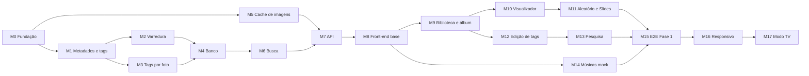

# Plano de implementação — Central de Mídia Local

Atualizado em 16/10/2026 · Complementa a `DOCUMENTACAO.md`

## Como o plano funciona

A construção é dividida em módulos pequenos. Cada módulo já tem seus testes automatizados escritos, e eles começam **falhando** porque o código ainda não existe. Um módulo está pronto quando os testes dele passam, sem quebrar os anteriores.

1. Escolher o próximo módulo na ordem abaixo.
2. Rodar só os testes dele: `npx vitest run m02` (o número do módulo filtra pelo nome do arquivo).
3. Escrever o código até ficar tudo verde.
4. Rodar a suíte inteira (`npm test`) para ver se nada anterior quebrou.
5. No fim de cada fase, rodar os testes ponta a ponta (`npm run test:e2e`).

Os testes são a especificação: nomes de arquivos, funções e rotas usados neles são o contrato. Se uma decisão mudar, o teste muda primeiro.

## Tecnologia

Escolhida a partir das primeiras opções da documentação, tudo em TypeScript:

| Camada | Escolha |
| --- | --- |
| Servidor | Node.js 22.13+ (instalado: 24), Fastify, executado com `tsx` |
| Banco | SQLite nativo do Node (`node:sqlite`), sem dependência compilada |
| Imagens e EXIF | sharp (redimensionar, orientar) e exifr (ler EXIF) |
| Front-end | React + Vite, React Router |
| Testes unitários e de integração | Vitest (projetos `servidor` em Node e `web` em jsdom) |
| Testes de componentes | Testing Library + user-event + jest-dom |
| Testes ponta a ponta | Playwright (perfis desktop, mobile e TV) |

## Comandos

| Comando | O que roda |
| --- | --- |
| `npm test` | Todos os testes unitários e de integração |
| `npm run test:servidor` | Só os testes do servidor (M0–M7) |
| `npm run test:web` | Só os testes do front-end (M8–M17) |
| `npx vitest run m07` | Só um módulo |
| `npm run test:watch` | Modo contínuo durante o desenvolvimento |
| `npm run test:e2e` | Testes ponta a ponta (antes, uma vez: `npx playwright install chromium`) |
| `npm run typecheck` | Verificação de tipos do TypeScript |

## Estrutura de pastas

```
Site/
  server/src/          ← código do servidor (a criar)
  web/src/             ← código do front-end (a criar)
  tests/
    ajuda/             ← gerador de bibliotecas de fotos de teste (pronto e testado)
    servidor/          ← m00 a m07
    web/               ← m08 a m17
    e2e/               ← fluxos completos no navegador
  DOCUMENTACAO.md
  PLANO_IMPLEMENTACAO.md
```

### Biblioteca de teste

`tests/ajuda/fixtures.ts` cria, numa pasta temporária, uma biblioteca de fotos real (JPEGs pequenos gerados com sharp, com EXIF quando preciso). A biblioteca padrão cobre os casos da documentação:

| Álbum | Conteúdo | Serve para testar |
| --- | --- | --- |
| Viagem Nordeste | 2 fotos no nível 1, 1 no 2, 1 no 3, 1 solta; pastas `Nivel_4` e `Extras`; `notas.txt` e `video.ts`; tags por foto | Níveis, contagem, avisos, arquivos ignorados, herança |
| Aniversario 2025 | 1 foto no nível 1, 2 no nível 2; título com acento no JSON | Título do JSON, tags em comum |
| Neve | `"oculto": true` | Álbum oculto |
| Sem Metadados | Sem pasta `metadados` | Valores padrão, aviso, criação do JSON |

## Ordem e dependências



Os módulos do servidor (M0–M7) podem ser feitos antes de qualquer tela. A partir do M8, o front-end usa a API real.

---

## Fase 1 — Fotos

### M0 · Fundação

Estrutura do projeto, servidor que sobe, banco com migrações e configuração.

- **Arquivos:** `server/src/config.ts`, `server/src/app.ts`, `server/src/db/banco.ts`, `server/src/principal.ts`
- **Contrato:**
  - `carregarConfig(env)` → `{ porta, caminhoBanco, caminhoCache }`; porta padrão 8001; erro se a porta for inválida.
  - `construirApp({ caminhoBanco, caminhoCache })` → instância Fastify com as rotas sob `/api`.
  - `abrirBanco(caminho | ':memory:')` aplica migrações; `versaoDoBanco(db)`.
  - Tabelas: `bibliotecas`, `albuns`, `fotos`, `album_tags`, `foto_tags`.
- **Testes:** `tests/servidor/m00-fundacao.test.ts` (7). Cobrem padrões e variáveis de ambiente, porta inválida, migração idempotente, `GET /api/saude` e 404 em JSON.

### M1 · Metadados e tags

Normalização de tags, leitura e gravação do `colecao.json` e gravação segura de arquivos.

- **Arquivos:** `server/src/metadados/tags.ts`, `colecao.ts`, `gravacaoAtomica.ts`
- **Contrato:**
  - `normalizarTag(texto)` → minúsculas, sem espaços nas pontas, espaços internos únicos, acentos mantidos; vazio vira `null`.
  - `normalizarTags(lista)` remove repetidas, mantendo a ordem.
  - `chaveBusca(tag)` → sem acentos, para comparar (`Família` = `familia`).
  - `lerColecao(pastaAlbum)` → `{ dados, aviso }`; aceita BOM; `oculto` padrão `false`.
  - `gravarColecao(pasta, dados)` e `atualizarColecao(pasta, alteracoes)`. O segundo preserva campos desconhecidos (ex.: `nome`, `cabelo`) e não grava `oculto: false` se o campo não existia.
  - `gravarJsonAtomico(caminho, objeto)`: grava num temporário e depois substitui; UTF-8 sem BOM; 2 espaços de indentação.
- **Testes:** `tests/servidor/m01-metadados.test.ts` (15).

### M2 · Varredura de Fotos

Transforma o caminho escolhido em álbuns, fotos, níveis, contagens e avisos.

- **Arquivos:** `server/src/fotos/niveis.ts`, `server/src/fotos/varredura.ts`, `server/src/imagens/exif.ts`
- **Contrato:**
  - `classificarSubpasta(nome)` → `{ tipo: 'nivel', nivel }`, `{ tipo: 'metadados' }` ou `{ tipo: 'ignorada' }` (sem diferença de maiúsculas).
  - `varrerBibliotecaFotos(raiz, { anterior? })` → `ResultadoVarredura { albuns, avisos, alteracoes }`.
  - Cada álbum: `{ nome, caminho, titulo, colecao, fotosJson, fotosJsonAlterado, fotos, contagem }`.
  - Cada foto: `{ caminhoRelativo (com /), nivel, tamanho, modificadoEm, exif }`.
  - `contagem`: `{ total, nivel1, nivel2, nivel3, semNivel }`.
  - Avisos: `pasta-ignorada`, `sem-metadados`, `json-invalido`, `tag-orfa`.
  - `previaBibliotecaFotos(raiz)` → `{ albuns: nomes, avisos }`, sem ler as fotos.
  - Caminho inexistente → erro com `codigo: 'caminho-invalido'`.
  - `lerExif(arquivo)` → `{ camera, orientacao, dataCaptura }`. A câmera junta marca e modelo sem repetir a marca. Foto sem EXIF devolve campos nulos.
- **Testes:** `tests/servidor/m02-varredura.test.ts` (19 casos, mais 8 variações de subpasta). Usam a biblioteca padrão e cobrem a varredura incremental (fotos novas, alteradas e removidas).

### M3 · Tags por foto

O arquivo `metadados/fotos.json`: ler, aplicar tags, gravar e reencontrar fotos movidas.

- **Arquivos:** `server/src/metadados/fotosJson.ts`
- **Contrato:**
  - `lerFotosJson(pasta)` → `{ fotosJson, aviso }`; sem arquivo → `{ versao: 1, fotos: {} }`; JSON inválido gera aviso e o arquivo não é apagado.
  - `aplicarTagsFotos(json, { fotos, adicionar, remover })`: função pura. Entrada que fica sem tags é apagada.
  - `gravarFotosJson(pasta, json)`: não cria o arquivo enquanto ele estiver vazio; mantém o arquivo se ele já existia.
  - `reconciliarFotosJson(json, arquivos, { datasAnteriores? })` → `{ fotosJson, corrigidas, orfas }`.
    - Reencontra a foto por mesmo nome e tamanho, ou por mesmo tamanho e mesma data EXIF; a data anterior vem do banco.
    - Com dois candidatos, não adivinha: a entrada vira órfã.
    - Nunca reaponta para um arquivo que já tem entrada própria.
- **Testes:** `tests/servidor/m03-tags-por-foto.test.ts` (15).

### M4 · Banco e índice

Guarda o resultado da varredura e mantém o índice que a pesquisa usa.

- **Arquivos:** `server/src/db/repositorio.ts`
- **Contrato:** `criarBiblioteca`, `listarBibliotecas`, `salvarVarredura(db, bibliotecaId, resultado)`, `listarAlbuns(db, id, { incluirOcultos?, incluirIndisponiveis? })`, `obterAlbum` (com `contagem` e `tags`), `listarFotosDoAlbum` (com `tags` próprias, em ordem de nível e nome).
- **Regras testadas:**
  - Os ids de álbuns e fotos se mantêm entre varreduras.
  - Álbum que some do disco fica indisponível, sem ser apagado, e volta com o mesmo id.
  - Tags que saem do JSON saem do índice.
  - Ocultos só aparecem quando pedidos.
- **Testes:** `tests/servidor/m04-banco.test.ts` (11).

### M5 · Cache de imagens

- **Arquivos:** `server/src/imagens/cache.ts`
- **Contrato:** `LARGURAS_PADRAO = [300, 600, 1200]`; `gerarVersoes(original, pastaCache, chave)` → `{ versoes: { 300, 600, 1200 }, geradas }`, com arquivos `<chave>-<largura>.jpg`.
- **Regras testadas:**
  - Mantém a proporção e não amplia fotos pequenas.
  - Aplica a orientação do EXIF e nunca altera o original (conferido por hash).
  - Reaproveita o cache na segunda chamada.
  - Imagem corrompida gera erro com `codigo: 'imagem-invalida'`.
- **Testes:** `tests/servidor/m05-cache-imagens.test.ts` (7).

### M6 · Busca

Funções puras de pesquisa, usadas pela API.

- **Arquivos:** `server/src/busca/tags.ts`
- **Contrato:**
  - `tagsEfetivas(proprias, doAlbum)` → `{ proprias, herdadas }`; uma tag repetida fica só nas próprias.
  - `filtrarAlbuns(albuns, { tags, modo: 'todas' | 'qualquer', incluirOcultos? })` considera só as tags do álbum.
  - `buscarFotos(albuns, { tags, modo, nivel? })` usa as tags da foto mais as herdadas do álbum e ignora álbuns ocultos. Cada resultado traz `albumId`, `albumTitulo`, `proprias` e `herdadas`.
  - `contarTags(albuns)` → `[{ tag, albuns, fotos, usos }]`, sem ocultos, em ordem de uso e depois alfabética.
- **Testes:** `tests/servidor/m06-busca.test.ts` (16).

### M7 · API

Junta tudo em rotas HTTP. Os testes rodam o servidor em memória sobre a biblioteca padrão.

| Rota | Uso |
| --- | --- |
| `GET /api/saude` | Verificação |
| `GET /api/libraries` · `POST /api/libraries` | Listar e criar (já varre; 400 com `caminho-invalido`) |
| `POST /api/libraries/previa` | Álbuns e avisos antes de salvar |
| `GET /api/fs?path=` | Navegador de pastas (sem `path`: unidades de disco) |
| `GET /api/libraries/:id/collections?tags=&modo=&incluirOcultos=` | Álbuns, com contagem por nível e pesquisa |
| `GET /api/collections/:id?incluirOcultos=` | Álbum (404 se oculto e o parâmetro não for enviado) |
| `GET /api/collections/:id/photos` | Fotos do álbum, com nível e tags |
| `GET /api/libraries/:id/photos?tags=&modo=&nivel=` | Pesquisa de fotos com herança |
| `GET /api/libraries/:id/tags` | Lista de tags existentes, com contagens |
| `PUT /api/collections/:id` | Editar (título, tags, oculto...), preservando campos desconhecidos |
| `PATCH /api/collections/tags` | Tags em massa → `{ alteradas, falhas }` |
| `PATCH /api/photos/tags` | Tags de uma ou várias fotos → `fotos.json` |
| `GET /api/items/:id/file` | Original com HTTP Range |
| `GET /api/photos/:id/imagem?w=300\|600\|1200` | Versão do cache |
| `POST /api/scan` | Nova varredura; grava correções do `fotos.json`; devolve avisos |

- **Testes:** `tests/servidor/m07-api.test.ts` (25), incluindo:
  - um `colecao.json` somente leitura, para conferir que a edição em massa salva o resto e lista a falha;
  - a gravação real dos JSON no disco.

### M8 · Front-end base

- **Arquivos:** `web/src/tema/tokens.css`, `web/src/logica/rotas.ts`, `web/src/tipos.ts`, `web/src/main.tsx`, layout com barra no topo, cliente da API.
- **Contrato:**
  - Tokens da paleta Brasa Neon com os valores da documentação.
  - `slug(texto)`.
  - `caminhoBiblioteca(id)` → `/biblioteca/3`.
  - `caminhoAlbum(album)` → `/album/12/viagem-nordeste`.
  - `caminhoFoto(album, fotoId)` → `/album/12/viagem-nordeste/foto/731`.
- **Testes:** `tests/web/m08-base.test.ts` (3 casos, mais 12 variações de token).

### M9 · Biblioteca e álbum

Grade de álbuns, cabeçalho do álbum (capa, poster, informações), grade de fotos, selo, filtro, ordenação, contagem por nível e card de álbum oculto.

- **Arquivos:** `web/src/logica/fotos.ts`, `componentes/SeloNivel.tsx`, `ContagemNiveis.tsx`, `FiltroNivel.tsx`, `CardAlbum.tsx`, páginas Biblioteca e Álbum.
- **Regras testadas:**
  - Ordenação por nível (as sem nível vão para o fim nos dois sentidos), por data (as sem data no fim) e por nome em ordem natural.
  - A contagem vira botão que aplica o filtro; "sem nível" só aparece se houver fotos soltas.
  - Botão de nível sem fotos fica desativado.
  - Card oculto tem `data-oculto` e selo.
- **Testes:** `tests/web/m09-album.test.tsx` (15).

### M10 · Foto expandida (visualizador)

- **Arquivos:** `web/src/componentes/Visualizador.tsx`, `web/src/logica/imagens.ts`
- **Contrato:** `<Visualizador fotos indiceInicial onFechar onMudarFoto onIniciarSlides plataforma />`; `urlImagem(id, largura?)`.
- **Regras testadas:**
  - Contador, selo e imagem de 1200 px.
  - ← → e ‹ › navegam e param nas pontas.
  - Pré-carrega a foto anterior e a próxima.
  - Fecha com Esc, com × e com clique fora da foto (clicar na foto não fecha).
  - Rodapé com nome, data e câmera; botão ⓘ abre as informações; ▶ inicia os slides a partir da foto aberta.
  - Sem zoom na TV.
  - Os controles somem após 3 s.
- **Testes:** `tests/web/m10-visualizador.test.tsx` (15).

### M11 · Aleatório e Slides

- **Arquivos:** `web/src/logica/slides.ts`
- **Contrato:** `sortearIndice(total, rng, atual?)`, `criarOrdemAleatoria(n, rng)` e `new Apresentacao({ total, modo, inicio?, intervaloMs?, rng?, aoTrocar? })`, com `proxima`, `anterior`, `iniciar`, `pausar`, `continuar` e `parar`.
- **Regras testadas:**
  - Novo sorteio não repete a foto atual.
  - No modo aleatório, nenhuma foto se repete até passarem todas, e um ciclo não começa com a foto que terminou o anterior.
  - Anterior volta pelo histórico.
  - O intervalo e a pausa funcionam.
- **Testes:** `tests/web/m11-slides.test.ts` (11).

### M12 · Edição de tags

Lista de tags existentes para selecionar, painel ⚙, edição em massa e tags da foto.

- **Arquivos:** `web/src/logica/tagPicker.ts`, `logica/edicaoMassa.ts`, `componentes/TagPicker.tsx`, `componentes/PainelTagsFoto.tsx`, painel ⚙ do álbum.
- **Contrato:**
  - `sugestoesTags({ existentes, aplicadas, texto, prioritarias? })` → `{ maisUsadas, todas, criar, parecida }`.
  - `tagsEmComum(listas)` e `calcularAlteracoesMassa({ emComum, resultado })`.
- **Regras testadas:**
  - Lista aberta ao focar, com 10 mais usadas e todas de A a Z; as já aplicadas somem.
  - Filtro sem acento; "Criar" só para tag nova; destaque para tag parecida (`famila` → `família`).
  - Tags do álbum atual primeiro.
  - Clique adiciona sem fechar a lista; Enter, vírgula e ↓ funcionam; × remove.
  - Herdadas aparecem com "do álbum" e sem ×; fora do desktop, tudo é só leitura.
- **Testes:** `tests/web/m12-edicao-tags.test.tsx` (17).

### M13 · Pesquisa por tags

- **Arquivos:** `web/src/logica/pesquisa.ts`, `componentes/BarraPesquisaTags.tsx`, `componentes/ResultadoVazio.tsx`
- **Contrato:** `estadoPesquisaDaUrl(search)` e `urlDaPesquisa(estado)`, com estado `{ tags, modo: 'todas' | 'qualquer', busca: 'albuns' | 'fotos' }`.
- **Regras testadas:**
  - Padrões (modo `todas`, busca de álbuns) omitidos da URL; valores inválidos ignorados; ida e volta preserva o estado.
  - Seletor Álbuns | Fotos e Todas | Qualquer.
  - Sugestão adiciona a tag com um clique.
  - Mensagem de resultado vazio com botão de limpar.
- **Testes:** `tests/web/m13-pesquisa.test.tsx` (9).

### M14 · Músicas mockada

- **Arquivos:** `web/src/mocks/musicas.json` (`{ emBreve: true, albuns: [...] }`) e artes de exemplo.
- **Testes:** `tests/web/m14-musicas-mock.test.ts` (4). Conferem 6 a 8 álbuns, três artes e faixas em cada um, ids únicos e o selo "Em breve".

### M15 · Testes ponta a ponta da Fase 1

Rodam no Chromium, em 1440 × 900, contra o servidor real e uma biblioteca temporária.

- **Arquivo:** `tests/e2e/fase1-fotos.spec.ts` (9 fluxos):
  - Criar a biblioteca pela interface, com prévia.
  - Contagem por nível que filtra.
  - Clicar na foto para expandir; setas, Voltar e Esc.
  - Link direto para uma foto.
  - Pesquisa de álbuns e de fotos com herança.
  - Tag existente escolhida no ⚙.
  - Ocultar e "Mostrar ocultos" (que some ao recarregar).
  - Aleatório e Slides.
  - Card de Músicas "Em breve".
- **Pronto quando:** M0–M14 verdes e os 9 fluxos passando. Fim da Fase 1.

---

## Fase 2 — Responsivo e TV

### M16 · Layout responsivo

- **Arquivos:** `web/src/plataforma.ts`, CSS por plataforma.
- **Contrato:** `detectarPlataforma({ largura, userAgent, caminho })` → `'mobile' | 'desktop' | 'tv'` e `colunasDaGrade(plataforma, modo, largura)`.
- **Regras testadas:**
  - Menos de 768 px é mobile; Tizen ou `/tv` é TV; monitor grande sem Tizen continua desktop.
  - Colunas da tabela "Layout responsivo" da documentação.
- **Testes:** `tests/web/m16-responsivo.test.ts` (8) e `tests/e2e/fase2-mobile.spec.ts` (3 fluxos: barra no topo sem Configurações, sem ⚙ no celular, tocar e deslizar no visualizador).

### M17 · Modo TV

- **Arquivos:** `web/src/tv/navegacao.ts`, rotas `/tv/...`, grade de tags da TV.
- **Contrato:** `acaoDaTecla(evento)` → `'esquerda' | 'direita' | 'cima' | 'baixo' | 'ok' | 'voltar' | 'playPause' | null`; `proximoFoco(atualId, direcao, retangulos)`; `MemoriaFoco` com `lembrar` e `recuperar`.
- **Regras testadas:**
  - Códigos do controle Samsung (Voltar 10009, Play/Pause 10252).
  - Foco anda na fileira e para no fim, sem dar a volta.
  - ↑ ↓ vão para a coluna mais próxima.
  - Memória de foco por tela.
- **Testes:** `tests/web/m17-tv.test.ts` (8 casos, mais 12 variações de tecla) e `tests/e2e/fase2-tv.spec.ts` (4 fluxos: foco e retorno, sem configurações nem campos de texto, grade de tags, visualizador).
- **Validação manual obrigatória na QN90B:** códigos reais das teclas, Voltar dentro do site, desempenho de grades grandes. Os testes simulam a TV no Chromium e não substituem a TV real.

---

## Fases 3 e 4 — previstas, sem testes escritos ainda

Os testes destas fases serão escritos quando cada uma começar, seguindo o mesmo padrão.

| Módulo | Escopo | Testes previstos |
| --- | --- | --- |
| M18 · Varredura de vídeo | Filmes, Séries, Vídeos; ffprobe; `.ts` ignorado | Estrutura de pastas, sagas, temporadas, dados técnicos |
| M19 · Player e progresso | HTTP Range, progresso, marca de visto | Retomar de onde parou, próximo episódio |
| M20 · Formatos por aparelho | `canPlayType`, selo "Não suportado" | Marcação por aparelho guardada após falha |
| M21 · Administração | Varredura agendada, monitoramento, backup | Agendamento, chokidar, restaurar banco |

## Decisões tomadas ao escrever os testes

Estas escolhas não estavam fechadas na documentação. Os testes já as seguem; se alguma mudar, ajuste o teste antes do código.

- **URL da foto pelo id:** `/album/12/viagem-nordeste/foto/731`, em vez do nome do arquivo, porque níveis diferentes podem ter arquivos com o mesmo nome. A documentação foi atualizada.
- **Rotas com prefixo `/api`**, para não colidirem com as rotas das telas.
- **Imagem redimensionada da foto** em `/api/photos/:id/imagem?w=`, separada de `/art/:id` (artes da coleção).
- **No visualizador, as setas param na primeira e na última foto** (não dão a volta), igual à regra das fileiras da TV.
- **Ao reencontrar uma foto renomeada**, a data EXIF anterior vem do banco, porque o `fotos.json` guarda só o tamanho.
- **Subpasta de nível** aceita maiúsculas e minúsculas (`nivel_2` vale); `Nivel_0` e `Nivel_4` são ignoradas.
- **Banco `node:sqlite`** em vez de better-sqlite3, para não depender de compilação nativa no Windows.

## Situação atual

Atualizado em 16/10/2026.

- **Fases 1 e 2 implementadas (M0–M17).** `npm test` passa 237 de 237; `npm run test:e2e` passa os 16 fluxos (9 desktop, 3 mobile, 4 TV); `npm run typecheck` sem erros.
- **Como rodar:** `npm run servidor` sobe a API e o site já compilado na porta 8001 (compile antes com `npm run build:web`). Para desenvolver o front-end com recarga automática, rode `npm run servidor` e `npm run web` juntos; o Vite repassa `/api` para o servidor.
- **Ainda não validado na QN90B real:** códigos reais das teclas, Voltar dentro do site e desempenho de grades grandes (validação manual obrigatória do M17).
- **M18 · Artes do álbum (implementado).** Poster, capa de fundo e miniatura vêm de campos `poster`, `capa` e `miniatura` do `colecao.json` (caminho relativo de uma foto do próprio álbum; `null` ou ausente = primeira foto). `PUT /api/collections/:id` aceita `artes: { poster?, capa?, miniatura? }` com ids de fotos do álbum (ou `null`) e recusa fotos de outro álbum (`arte-invalida`). A API devolve `posterFotoId`, `capaFotoId` e `miniaturaFotoId`. Interface: seção "Imagens do álbum" no painel ⚙ e "Usar como" no painel ⓘ do visualizador. Na varredura, uma arte cuja foto mudou de pasta (ex.: de nível) é reapontada para a única foto do álbum com o mesmo nome de arquivo (`reapontarArtes`). A grade de álbuns da biblioteca alterna entre Miniatura (16:9) e Poster (2:3), e a escolha fica no `localStorage` do navegador; a TV continua só com miniaturas. Proporções ideais (recorte pelo centro com `object-fit: cover`): poster 2:3 (mín. 600 × 900), miniatura 16:9 (mín. 600 × 338), capa de fundo 16:9 (mín. 1200 × 675); tabela no README.
- **Barra no topo (substitui a barra lateral do desktop e a inferior do mobile).** `Layout.tsx`: botão Voltar (volta no histórico do site; sem histórico, vai para o Início; desativado no Início sem histórico), nome do site (link para o Início), Início e ⚙ Configurações (só desktop). Fixa no topo (`--altura-topo: 56px`); escondida na TV. Teste: fluxo "barra no topo" em `fase1-fotos.spec.ts`. Testes: `tests/web/m18-artes-album.test.tsx`, `tests/servidor/m18-artes.test.ts`, 3 casos em `m07-api.test.ts` e 2 fluxos em `fase1-fotos.spec.ts`.
- **Simplificações a revisitar:**
  - Na TV, a página do álbum ainda não tem a fileira de filtro por nível.
  - No visualizador da TV e da pesquisa de fotos, a foto aberta não muda a URL.
- **Decisões tomadas na implementação:**
  - Extensões aceitas: jpg, jpeg, png e webp.
  - Subpastas dentro de uma pasta de nível não são lidas e geram aviso.
  - Pastas de sistema do Windows na raiz da biblioteca são ignoradas.
  - JPEG do cache com qualidade 82; transparência achatada sobre `#140c0a`.
- **Fases 3 e 4 (M18–M21):** ainda sem testes, como previsto.
