# Croma — Manual de marca v0.1 "Barras"

- **Versão:** 0.1, 05/11/2026
- **Status:** **identidade oficial do Croma**, decidida pelo usuário em 05/11/2026. Este manual é a fonte da verdade (veja a seção 13).
- **Pranchas e código:** `fontes/*.dc.html` · imagens em `imagens/` (01 a 39) · logotipo, símbolo e ícones em `logos/` · ícones do app em `logos/app/`

---

## 1. O que é o Croma

O Croma é um servidor de mídia pessoal (uma versão própria do Jellyfin). Ele reúne filmes, séries, música, fotos, TV ao vivo e livros, e roda em TV, desktop e celular.

A marca nasce de três ideias:

1. **As barras de cor das TVs antigas.** O padrão de teste servia para regular a imagem. No Croma, cada barra vira um tipo de mídia.
2. **A moldura da National Geographic, deitada.** Em vez do retângulo vertical de revista, uma moldura 16:9, como uma tela de TV.
3. **"Croma" como luz e espectro.** Cada cor carrega o seu comprimento de onda (λ), como numa espectrometria.

**Personalidade:** técnica, direta, um pouco nostálgica, e bem-humorada nos detalhes (descanso de tela, "sem sinal"). Fala de imagem e som com precisão, sem exagero.

---

## 2. Logotipo e símbolo

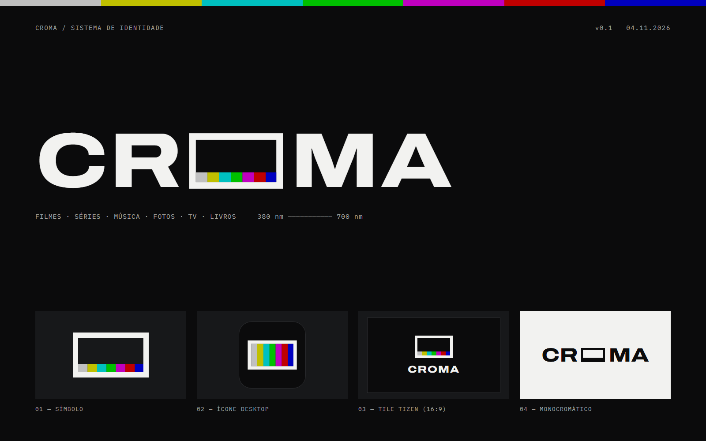

### Peças

| Peça | Descrição | Arquivo |
|---|---|---|
| **Logotipo** | "CR▭MA": o "O" é a moldura 16:9 com a faixa de barras na base. Archivo Expandida 800, em curvas. | `logos/croma-logotipo.svg` (fundo escuro), `-fundo-claro`, `-mono-claro`, `-mono-escuro` |
| **Símbolo** | A moldura sozinha, com a faixa de barras. | `logos/croma-simbolo.svg` |
| **Símbolo mono** | Moldura e faixa em uma cor só. | `logos/croma-simbolo-mono.svg` |
| **Ícone do app** | Moldura preenchida pelas barras, como uma tela de teste. | `logos/croma-icone-app.svg` e `logos/app/` (PNG e ICO por plataforma) |

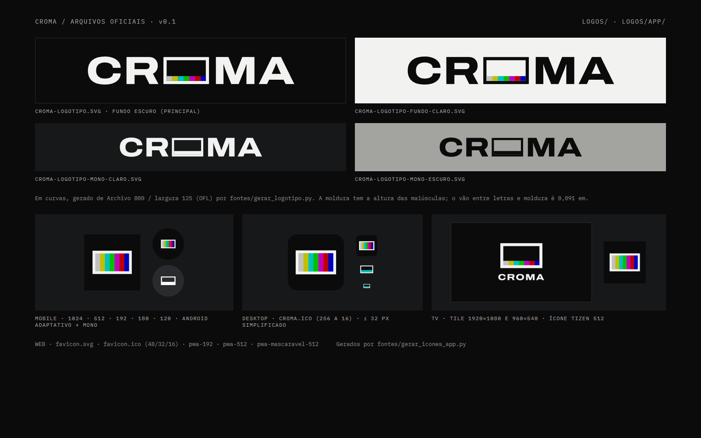

**Construção do logotipo:**
- o símbolo tem a altura das maiúsculas;
- o vão entre as letras e a moldura é de 0,091 em;
- o espaçamento entre letras é de 0,01 em.

Os arquivos são gerados por `fontes/gerar_logotipo.py`, a partir da Archivo (licença OFL).

### Construção do símbolo

- Caixa de 172 × 102 (proporção 16:9 por dentro).
- Moldura com traço de 12 unidades: um quinze avos da largura útil.
- Faixa de barras com 18 unidades de altura (20% da altura interna), encostada na base.
- 7 barras de mesma largura, na ordem do padrão de teste: branco, amarelo, ciano, verde, magenta, vermelho e azul.

### Área de proteção e tamanho mínimo

- **Área de proteção:** em volta do símbolo, deixe livre a espessura de duas molduras. No logotipo, a altura da faixa de barras.
- **Tamanho mínimo:**
  - símbolo com barras: 32 px de largura;
  - abaixo disso, use o mono (até 16 px);
  - logotipo: 96 px de largura.

### Não faça

- Girar, inclinar ou distorcer a moldura.
- Mudar a ordem das barras ou trocar as cores.
- Arredondar os cantos da moldura. A v0.1 é de cantos vivos.
- Pôr sombra, brilho ou gradiente no símbolo.
- Usar o logotipo sobre imagem sem a faixa escura por baixo.
- Escrever "Croma" em outra fonte no lugar do logotipo.

---

## 3. Cores

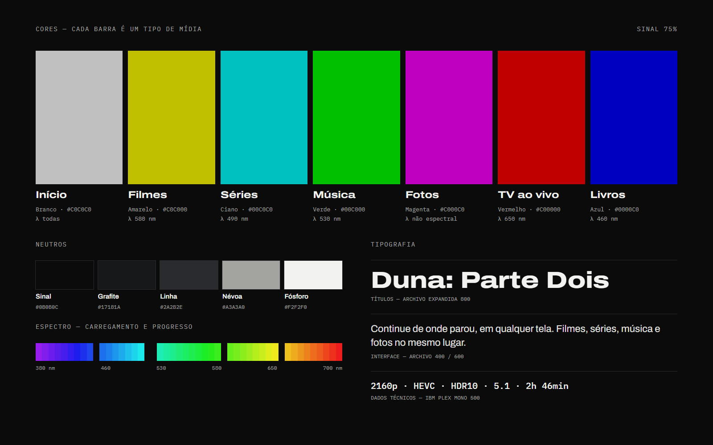

### Barras = bibliotecas

Os valores são os do padrão de teste em 75%.

| Barra | HEX | Biblioteca | λ | Uso |
|---|---|---|---|---|
| Branco | `#C0C0C0` | Início | todas | barra do menu, faixa |
| Amarelo | `#C0C000` | Filmes | 580 nm | tags, progresso, "visto" |
| Ciano | `#00C0C0` | Séries | 490 nm | tags, progresso, fita de episódios |
| Verde | `#00C000` | Música | 530 nm | tags, progresso, "Reprodução direta" |
| Magenta | `#C000C0` | Fotos | não espectral | tags |
| Vermelho | `#C00000` | TV ao vivo | 650 nm | tags, "ao vivo" |
| Azul | `#0000C0` | Livros | 460 nm | só na faixa de barras |
| Azul legível | `#3B3BFF` | Livros | 460 nm | qualquer uso pequeno sobre o escuro |

### Neutros

| Nome | HEX | Uso |
|---|---|---|
| Sinal | `#0B0B0C` | fundo de tudo |
| Grafite | `#17181A` | superfícies, botões secundários, chips |
| Linha | `#2A2B2E` | divisórias, trilho de progresso, avatar |
| Cinza médio | `#8A8B8E` | legendas apagadas, itens inativos (contraste de cerca de 5,7:1 sobre Sinal; era `#6E6F72`, que não passava dos 4,5:1) |
| Névoa | `#A3A3A0` | texto secundário |
| Fósforo | `#F2F2F0` | texto principal, foco, botão principal |

### Espectro

O espectro é um gradiente de 380 a 700 nm. É usado só na linha do tempo do player e no mini player de música.

```
#5A00B4 0% · #2A2AFF 18% · #00C0C0 36% · #00C000 52% · #C0C000 68% · #E07000 82% · #C00000 100%
```

### Regras de cor

- **A cor da biblioteca é um sinal pequeno:** um quadrado de 10 a 16 px, uma barra de progresso, a barra do menu, um acento no ícone. Nunca um fundo grande.
- **O foco é sempre Fósforo (branco),** em qualquer biblioteca.
- Texto sobre cor de barra: use Sinal sobre amarelo, ciano e verde, e Fósforo sobre vermelho, magenta e azul.
- **Exceção funcional:** a tela de calibração usa as cores reais do padrão de teste, inclusive o branco 100% e o PLUGE.

---

## 4. Tipografia

| Uso | Fonte | Peso | Detalhe |
|---|---|---|---|
| Logotipo, títulos de tela, nomes de obra | Archivo Expandida (`font-stretch: 125%`) | 800 | entrelinha 1,0 |
| Interface, botões, corpo | Archivo | 400 / 600 / 700 | entrelinha 1,45 |
| Dados técnicos, rótulos, tempos | IBM Plex Mono | 400 / 500 | rótulos em caixa alta com espaçamento 0,12 em |

**Escala por plataforma (px de CSS):**

| | Mobile | Desktop | TV |
|---|---|---|---|
| Título de tela | 32 | 48 | 64 |
| Título de obra (destaque) | 28 | 48 | 64 |
| Corpo | 16 | 16 | 22 |
| Rótulo mono | 11 | 13 | 16 |
| Legenda mono | 10 | 12 | 14 |

- **Números e tempos** (1:02:04, 2160p, 48 min) sempre em mono.
- **Rótulos técnicos** em mono e caixa alta: `FILME · EM DESTAQUE`, `λ 580 nm`.
- **Frases e botões** em caixa de frase: "Tentar agora", não "TENTAR AGORA".

---

## 5. Ícones das bibliotecas

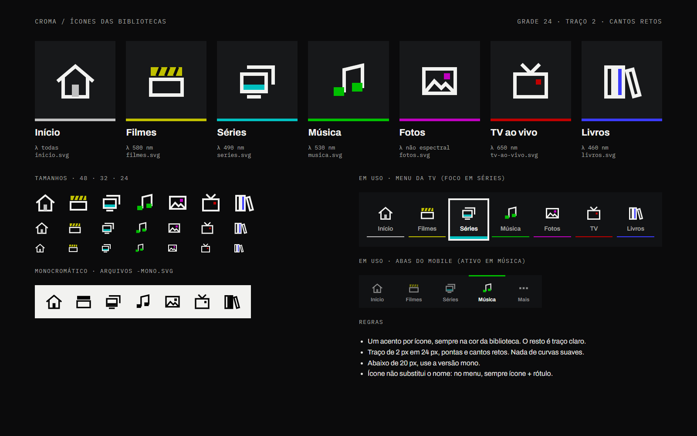

| Biblioteca | Desenho | Acento | Arquivo |
|---|---|---|---|
| Início | casa com a porta em destaque | porta em branco | `inicio.svg` |
| Filmes | claquete | tampa listrada em amarelo | `filmes.svg` |
| Séries | duas telas sobrepostas | faixa da tela da frente em ciano | `series.svg` |
| Música | duas notas com haste ligada | cabeças das notas em verde | `musica.svg` |
| Fotos | moldura com montanhas | sol quadrado em magenta | `fotos.svg` |
| TV ao vivo | TV com antena | ponto "no ar" em vermelho | `tv-ao-vivo.svg` |
| Livros | três lombadas, uma inclinada | lombada do meio em azul | `livros.svg` |
| Mais (utilitário) | três quadrados | sem acento | `mais.svg` |

- **Grade:** 24 × 24, traço de 2 px, pontas e cantos retos (`stroke-linecap: square`, junções em ângulo).
- **Um acento por ícone,** na cor da biblioteca. O resto é traço Fósforo.
- **Versão mono** (`-mono.svg`): tudo em `currentColor`. Use abaixo de 20 px ou sobre fundos claros.
- **Rótulo:** no menu, o ícone vem sempre com o nome. O ícone sozinho só aparece em espaços muito apertados, com `aria-label`.
- **Arquivos:** ficam em `logos/icones/`. São gerados por `fontes/gerar_icones.py`, então mude o desenho lá e rode o script de novo.

---

## 6. Formas e grade

- **Cantos vivos em tudo:** botões, cartões, chips, etiquetas. A única curva é a do aparelho (ícone do app no mobile e no desktop, moldura do celular).
- **Moldura:** a borda grossa é o elemento que mais identifica a marca. Ela aparece em:
  - destaques;
  - miniaturas de busca;
  - painéis de alerta.

  Sempre com a faixa de barras na base quando emoldura uma imagem.
- **Proporções:**
  - 2:3 para pôsteres de filme;
  - 16:9 para séries, episódios, destaques e miniaturas;
  - 1:1 para música.
- **Espaçamento:** múltiplos de 4. Os mais usados são 8, 12, 16, 24, 32, 36, 40 e 48.

---

## 7. Componentes

### Botões

| Tipo | Aparência |
|---|---|
| Principal | fundo Fósforo, texto Sinal, Archivo 700 |
| Secundário | fundo Grafite, texto Fósforo |
| Terciário | sem fundo, contorno de 2 px `#4A4B4F` |
| Ícone (player) | quadrado Grafite de 72 px (TV) ou 44 px (desktop) |

### Foco e estados

| Estado | TV | Desktop | Mobile |
|---|---|---|---|
| Foco em cartão | borda Fósforo de 8 px | borda de 4 px (teclado ou controle) | não se aplica |
| Foco em botão | fundo Fósforo e contorno de 4 px afastado 4 px | igual à TV | não se aplica |
| Passar o mouse | não se aplica | borda de 4 px e botão de assistir no centro | não se aplica |
| Pressionado | não se aplica | não se aplica | contorno de 3 px ou fundo Grafite |
| Seção ativa | barra de 6 px embaixo | barra vertical de 4 px e fundo Grafite | barra de 3 px em cima da aba |

### Cartões e indicadores

- **Visto:** quadrado de 18 a 26 px na cor da biblioteca, com ✓ em Sinal. O título fica em Névoa.
- **Progresso:** barra de 4 a 6 px na base do cartão, na cor da biblioteca, sobre um trilho escuro translúcido.
- **Novos episódios:** etiqueta ciano com `+2` em mono.
- **Etiqueta de tipo:** quadrado colorido, seguido do rótulo mono em caixa alta.

### Fita de episódios (séries)

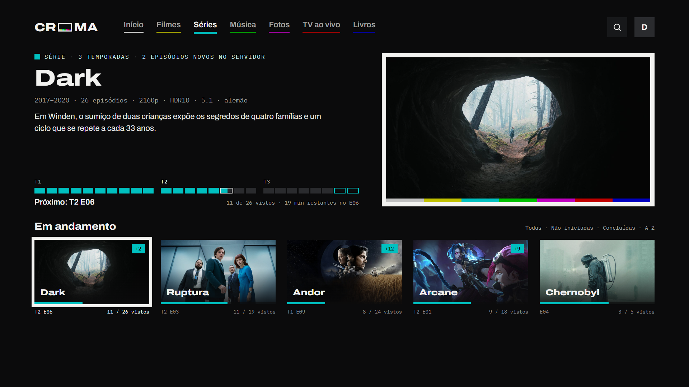

Um segmento por episódio, agrupado por temporada:

- ciano cheio: visto;
- parcial com borda Fósforo: em andamento;
- Linha: não visto;
- só o contorno ciano: episódio novo.

### Linha do tempo em espectro (player)

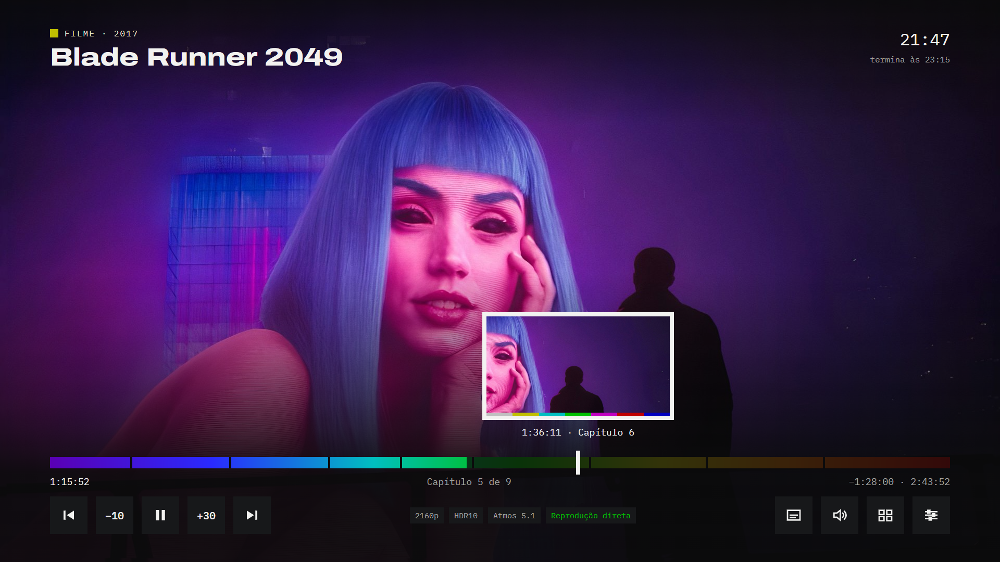

- A parte assistida aparece em espectro, com cores cheias. O resto fica a 22% de opacidade.
- Os capítulos são linhas escuras de 4 px, como linhas de absorção.
- A cabeça de leitura é um traço Fósforo de 8 px.
- Ao buscar, a barra engrossa e aparece a miniatura na moldura com barras, com o tempo e o capítulo.

### Música

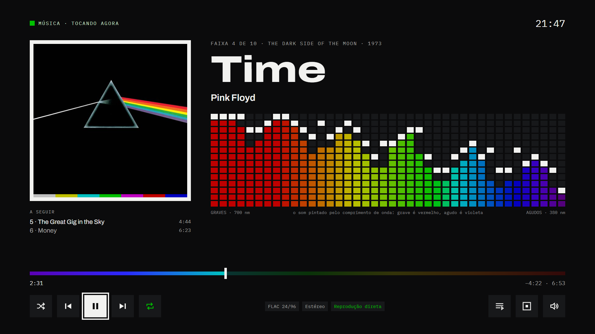

- **Capa de álbum:** 1:1, na moldura com a faixa de barras, como o destaque dos filmes.
- **Faixa tocando:** número em verde, título em negrito, mini equalizador de 3 barras e fundo Grafite.
- **Analisador de espectro:**
  - colunas de blocos quadrados, como os aparelhos de som antigos;
  - cada coluna tem a cor do comprimento de onda da sua frequência: graves em vermelho (700 nm), agudos em violeta (380 nm);
  - o pico fica marcado em Fósforo.
- **Capas de playlist geradas:**
  - 7 barras com as cores de uma faixa do espectro, em 75% como o padrão de teste;
  - placa Sinal embaixo com o nome em Archivo Expandida e a faixa em nm;
  - exemplos: Mix Croma (380–700), Graves (590–700), Foco (450–495), Verde (495–570).
- **Capa de artista:**
  - com foto, usa a foto;
  - sem foto, monta um mosaico com até 2 capas de álbuns dele, separadas por um fio Fósforo de 4 px;
  - com 1 álbum só, usa a capa dele.

  Uma etiqueta mono no canto indica a origem (FOTO, MOSAICO ou CAPA), para ninguém achar que o mosaico é a arte oficial.
- **Mini player** (desktop e mobile): fica acima da navegação, com capa, faixa, artista, pausar e uma linha de progresso em espectro de 3 a 4 px.

### Capa gerada (itens sem arte)

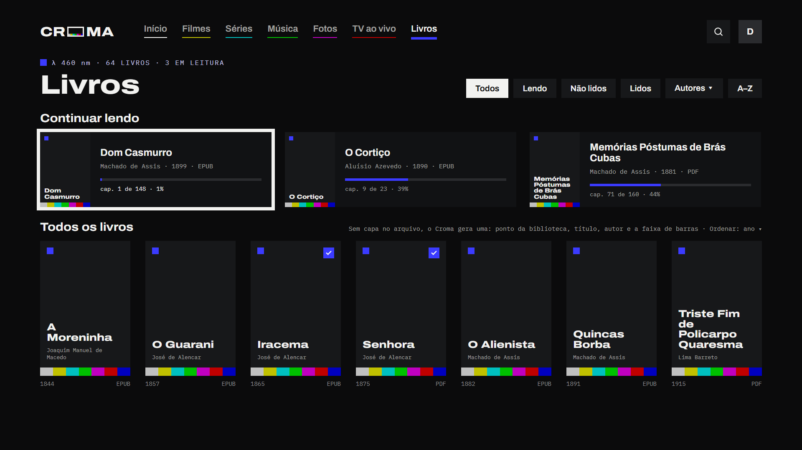

Esta é a regra oficial para qualquer filme, série, álbum ou livro que não tenha arte.

- **Fundo e forma:**
  - fundo Grafite `#17181A`, cantos vivos;
  - proporção do tipo de mídia: 2:3 para livros, filmes e séries, 1:1 para música.
- **Elementos (medidas para uma capa de 216 px de largura):**

  | Elemento | Medida | Proporção |
  |---|---|---|
  | Quadrado na cor da biblioteca, no canto superior esquerdo | 16 px | cerca de 7% da largura |
  | Título embaixo à esquerda, Archivo Expandida 800 Fósforo | 24 px, entrelinha 1,02 | cerca de 11% da largura |
  | Autor ou artista (e ano) em IBM Plex Mono Névoa | 13 px | — |
  | Margem interna | 16 px | cerca de 7% da largura |

- **Faixa de barras:** as 7 barras do padrão de teste ficam na base, encostadas nas bordas, com cerca de 6% da altura.
- **Estados:** lido ou visto e progresso entram por cima, como nos pôsteres reais.

### Capa de artista e avatar de perfil

- **Artista:**
  - com foto, usa a foto;
  - sem foto, monta um mosaico com até 2 capas de álbuns dele, separadas por um fio Fósforo de 4 px;
  - com 1 álbum só, usa a capa dele.

  Uma etiqueta mono indica a origem: FOTO, MOSAICO ou CAPA.
- **Perfil:**
  - quadrado de 240 px (TV) com 7 barras de uma faixa do espectro e uma placa Sinal de 112 px com a inicial em Archivo Expandida 800;
  - o perfil convidado não tem barras: fundo Grafite, inicial em Névoa.

### Páginas de detalhe

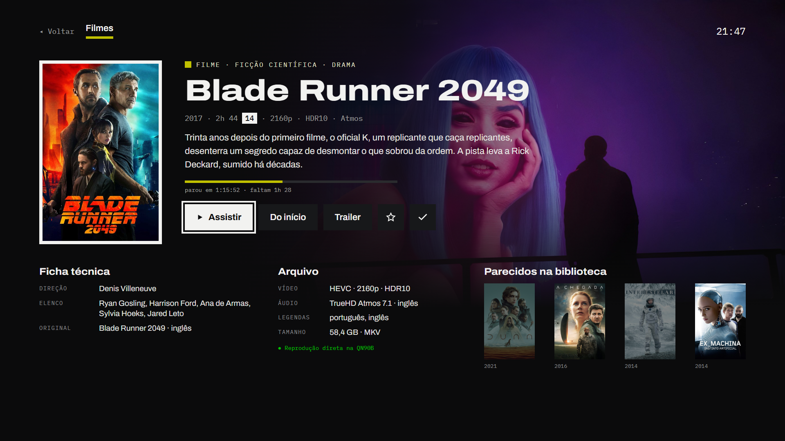

- **Menu reduzido:** "◂ Voltar" (ou o nome da série) e a seção ativa com a barra grossa, mais a hora à direita.
- **Filme:**
  - backdrop com véu, pôster com borda Fósforo de 8 px, título e dados em mono;
  - etiqueta de classificação: número em mono sobre Fósforo;
  - progresso "parou em X · faltam Y" na cor da biblioteca, sempre fora das molduras;
  - ações secundárias em quadrados Grafite de 64 px: favoritar ★ e visto ✓.
- **Faixa de baixo:** ficha técnica, dados do arquivo (codec, áudio, tamanho, "● Reprodução direta na QN90B") e "Parecidos na biblioteca".
- **Episódio:** imagem na moldura, a fita de episódios da temporada e a lista com o episódio atual em Grafite.

### Formulários e controles (TV, px de CSS)

| Componente | Medidas e regras |
|---|---|
| Tecla do teclado | 80 × 64, Grafite, Archivo 600 de 26 px. Grade de 6 colunas com 8 px entre teclas. Em foco, igual ao botão. Linha de baixo: Espaço, Apagar e Microfone, na proporção 2:1:1. |
| Campo de busca | 72 px de altura, texto Archivo 700 de 40 px, linha de base Fósforo de 4 px, cursor de 4 × 40 px que não pisca. |
| Campo de texto | 64 px de altura, contorno de 2 px `#4A4B4F`, fundo Sinal, texto de 24 px, rótulo mono de 13 px em caixa alta. |
| Alternância | Trilho de 76 × 40 com cursor quadrado de 28 px. Ligado: trilho Fósforo. Desligado: trilho Linha. Sempre com "Ligado" ou "Desligado" escrito ao lado. |
| Seleção segmentada | Segmentos de 52 px com 4 px entre eles. O escolhido tem fundo Fósforo e texto Sinal. |
| Seletor de passo | ◂ valor ▸, 52 px de altura, fundo Grafite. |
| Abas | Archivo 600 de 22 px. A ativa tem barra Fósforo de 4 px (no player, na cor da biblioteca). |
| Linha de lista | 88 a 96 px de altura. Em foco, fundo Fósforo e contorno de 4 px afastado 4 px. |
| Item marcado em lista | Quadrado na cor da biblioteca com ✓ e fundo Grafite. |
| Código de autorização | Mono 500 de 96 px, com barra de validade de 6 px. |

### Avisos, carregamento e estados

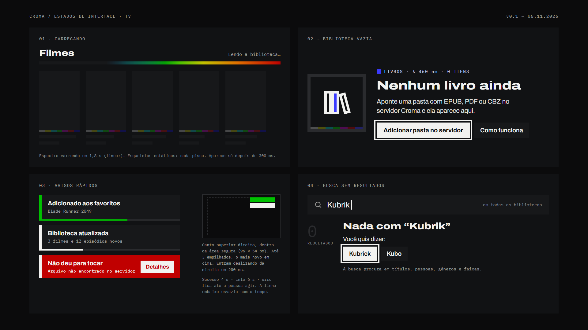

- **Avisos rápidos:** cartão Grafite com faixa de 8 px à esquerda, título em Archivo 700, detalhe em mono e linha de tempo de 4 px.

  | Tipo | Visual | Duração |
  |---|---|---|
  | Sucesso | faixa verde `#00C000` | 4 s |
  | Informação | faixa Fósforo | 6 s |
  | Erro | cartão inteiro `#C00000`, texto Fósforo | fica até a pessoa agir |

  Os avisos ficam no canto superior direito, dentro da área segura, até 3 empilhados. Entram em 200 ms com `ease-enter`.
- **Carregando:**
  - um trecho aceso varre a faixa do espectro em 1,8 s, linear, e só aparece depois de 300 ms;
  - os cartões-esqueleto são blocos Grafite com a faixa de barras a 28% e não piscam;
  - com movimento reduzido, a faixa fica parada a 60%.
- **Vazio:** moldura apagada com o ícone da biblioteca, rótulo mono "0 ITENS", título curto e a ação principal em foco.
- **Busca sem resultados:** um "0" grande apagado, "Nada com “termo”" e sugestões em chips.

### Player: menus, próximo episódio e carregamento

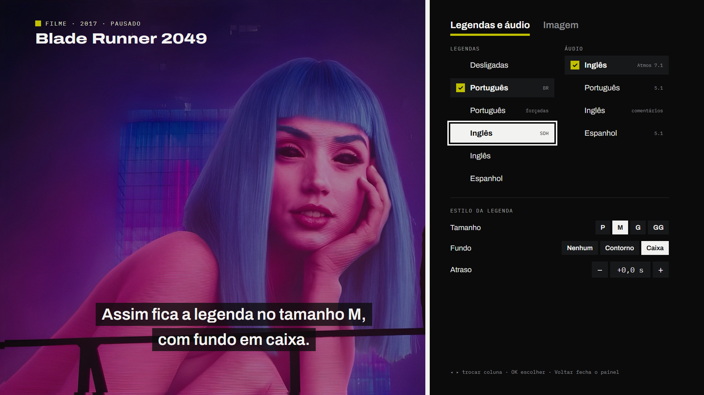

- **Painel lateral:**
  - entra pela direita, com 760 px, fundo Sinal e borda esquerda Fósforo de 12 px (a moldura);
  - o vídeo fica pausado e 35% mais escuro, e "Voltar" fecha o painel.
- **Legendas e áudio:** listas de faixas, estilo de legenda (tamanho P, M, G, GG; fundo Nenhum, Contorno ou Caixa) e atraso em mono (`+0,0 s`).
- **Próximo episódio:**
  - o vídeo encolhe para a moldura e aparece o cartão "T2 E07";
  - a contagem de 8 s é uma barra na cor da série que esvazia;
  - "Assistir agora" já vem em foco.
- **Pular abertura:**
  - botão claro no canto inferior direito, já em foco, só durante a abertura marcada no servidor;
  - some 1 s depois do fim da abertura.
- **Selo de reprodução:**
  - "Reprodução direta" em verde `#00C000`;
  - "Convertendo no servidor" (transcodificação) em amarelo `#C0C000`, junto com o que está sendo convertido (ex.: `2160p → 1080p`).
- **Linha do tempo com carregamento:**
  - assistido: espectro a 100%;
  - já carregado: coberto por Sinal a 50%;
  - ainda não carregado: coberto por Sinal a 82%.

### TV ao vivo

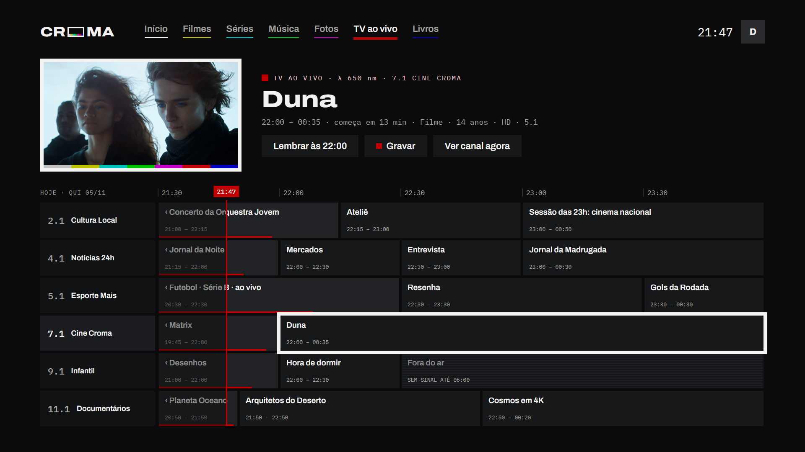

- **Selo AO VIVO:** fundo `#C00000`, quadrado Fósforo de 10 px e texto mono em caixa alta.
- **Guia:**
  - régua a cada 30 min;
  - linha do "agora" vermelha, de 3 px, com a hora na régua;
  - o que já passou fica sob um véu Sinal de 45%;
  - o programa em exibição leva uma barra vermelha de 4 px.
- **Canal fora do ar:** listras horizontais de 2 px e "SEM SINAL ATÉ hh:mm".
- **Troca de canal:** 300 ms no total. São de 100 a 200 ms de estática fina (o mesmo ruído da tela "Sem sinal") e depois um corte seco.

### Fotos e livros

- **Fotos:**
  - grade justificada: cada fileira ocupa a largura toda e cada foto mantém sua proporção, com 12 px entre elas;
  - agrupamento por mês, com cabeçalho mono;
  - favorita: quadrado magenta com ★, no lugar do "visto";
  - vídeo: etiqueta "▶ 0:42".
- **Visualizador:** fita de miniaturas proporcionais, com a atual com borda Fósforo de 4 px.
- **Leitor de livros:**
  - corpo de 32 px na TV, coluna de cerca de 1040 px, entrelinha 1,6;
  - temas Escuro (Sinal) e Papel (Fósforo com texto Sinal);
  - progresso azul `#3B3BFF` com página e tempo restante.

---

## 8. Movimento

| Token | Duração | Uso |
|---|---|---|
| rápido | 100 ms | troca de estado de botão; intervalo entre as barras na abertura |
| padrão | 200 ms | foco, passar o mouse, aviso rápido entrando, cada barra da abertura |
| médio | 300 ms | troca de canal (estática + corte), nome aparecendo na abertura |
| longo | 450 ms | troca de tela, painel lateral do player, moldura se desenhando na abertura |
| muito longo | 800 ms | entradas grandes e raras; a abertura inteira leva 1,9 s |

- **Curva:** `cubic-bezier(0.2, 0, 0, 1)` para entradas, linear para movimento contínuo (descanso de tela, estática).
- **O foco não anima a escala** na v0.1: a borda aparece de uma vez, como uma troca de canal.
- **Movimento contínuo só onde ele informa algo:**
  - telas de espera (descanso de tela e sem sinal);
  - analisador de espectro da música;
  - indicador de carregamento (o espectro varre em 1,8 s);
  - varredura de servidores (as barras acendem em ciclo de 2,1 s);
  - contagens regressivas (próximo episódio, código de autorização).

  Tudo respeita `prefers-reduced-motion`: as animações param no estado final ou ficam paradas.
- **Nada gira, pisca nem quica.** O cursor dos campos de texto é fixo.

---

## 9. Telas especiais

### Abertura

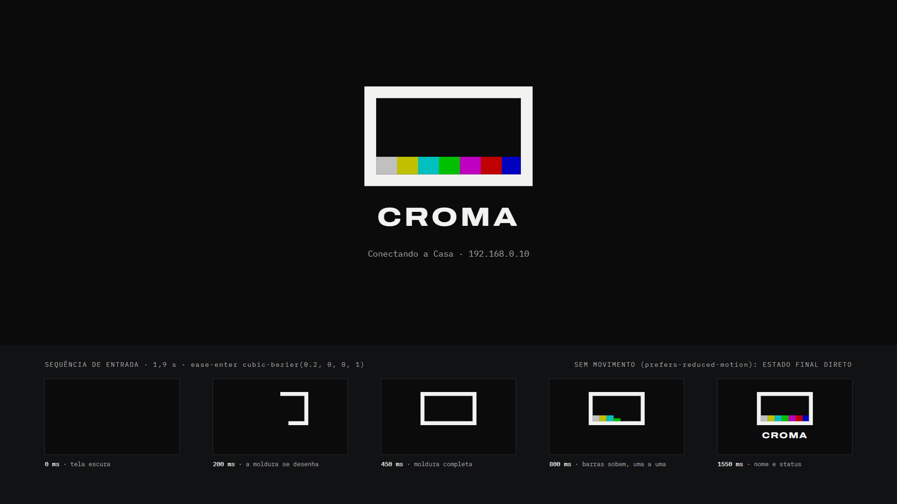

A sequência dura 1,9 s, com `ease-enter`:
1. A moldura se desenha em 450 ms, a partir do centro da borda de cima.
2. As 7 barras sobem da esquerda para a direita, uma a cada 100 ms.
3. "CROMA" aparece em 300 ms.
4. O status de conexão aparece em mono.

Com movimento reduzido, o estado final aparece direto.

### Tela de calibração

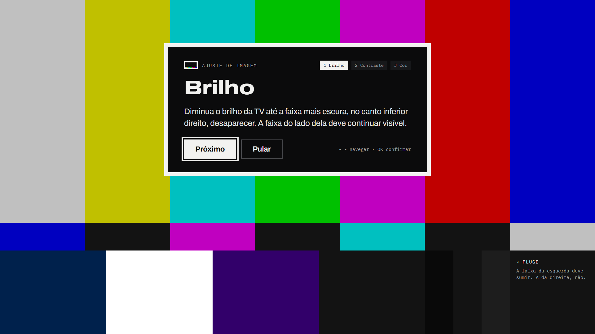

É uma função real, em Ajustes › Imagem. Usa o padrão de barras completo e guia o ajuste em três etapas: **Brilho** (PLUGE), **Contraste** e **Cor** (modo só azul).

### Descanso de tela

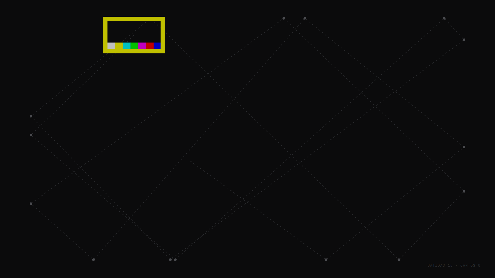

- **Visual:** fundo Sinal e só o símbolo, em 240 px na TV.
- **Movimento:**
  - Começa em posição e direção sorteadas.
  - Ao bater numa borda, troca para a cor da barra seguinte e desvia ±12° do ângulo.
  - O ângulo fica sempre entre 25° e 65°.
- **Canto em cheio:** a moldura se enche de barras por 2,4 s.
- **Quando entra:**
  - na TV e no desktop, depois de 5 min parado no menu;
  - nunca durante a reprodução.

### Sem sinal

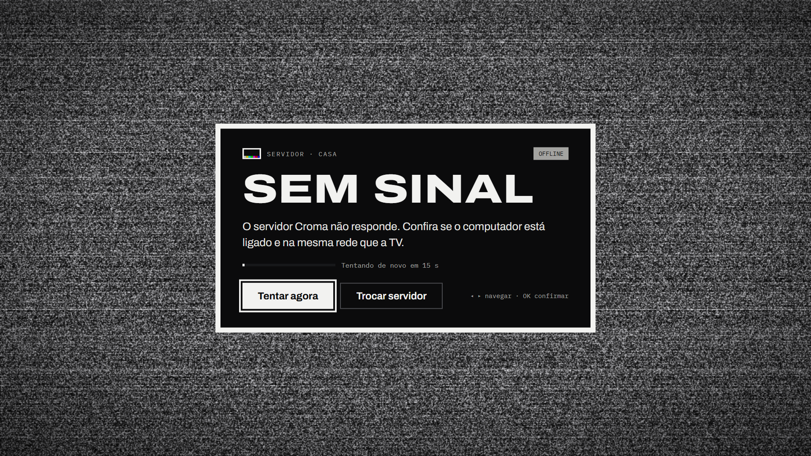

- **Fundo:** estática animada, com linhas de varredura, faixa rolante e bordas de tubo.
- **Painel:** emoldurado, com "SEM SINAL" e uma nova tentativa automática a cada 15 s.
- **Dois casos:**
  - **servidor fora do ar:** a segunda ação é "Trocar servidor";
  - **canal de TV ao vivo sem transmissão:** a segunda ação é "Guia de canais".

---

## 10. Plataformas

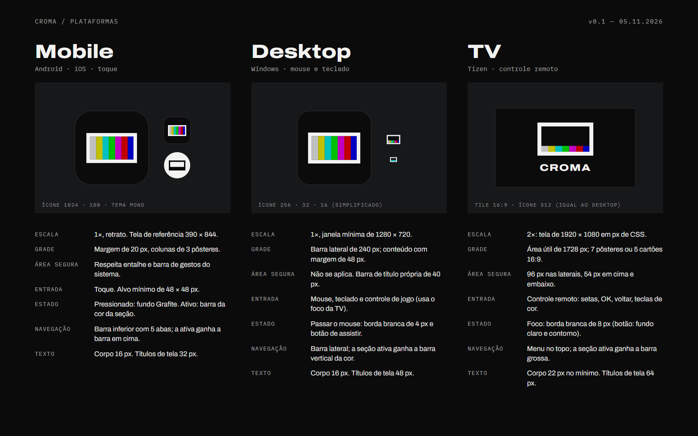

| | Mobile | Desktop | TV |
|---|---|---|---|
| Sistemas | Android, iOS | Windows | Tizen (Samsung QN90B) |
| Escala | 1×, retrato, referência 390 × 844 | 1×, janela mínima 1280 × 720 | 2×, 1920 × 1080 px de CSS |
| Margens | 20 px + áreas seguras do sistema | barra lateral de 240 px + 48 px | 96 px nas laterais, 54 px em cima e embaixo |
| Entrada | toque (alvo ≥ 48 px) | mouse, teclado, controle de jogo | controle remoto |
| Navegação | 5 abas embaixo (Início, Filmes, Séries, Música, Mais) | barra lateral com as 7 bibliotecas | menu no topo |
| Grade de filmes | 3 colunas | 7 colunas de 160 px | 7 colunas de 216 px |
| Ícone | quadrado com cantos do sistema + versão mono (`logos/app/mobile/`) | `croma.ico` de 256 a 16, simplificado até 32 px (`logos/app/desktop/`) | tile 16:9 com o nome + ícone 512 (`logos/app/tv/`) |

### TV

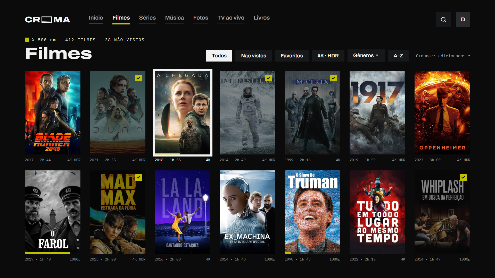

- **Telas desenhadas:**
  - **entrada:** abertura, perfis e servidor;
  - **bibliotecas:** Início, Filmes, Séries, Música (galeria, álbum, artista e tocando agora), Fotos (galeria e visualizador), TV ao vivo (guia e canal) e Livros (galeria e leitor);
  - **detalhes:** filme e episódio;
  - **player:** com busca, legendas e áudio, próximo episódio e carregando;
  - **apoio:** busca, ajustes, calibração, estados, descanso de tela e sem sinal.
- Tudo é pensado para o controle remoto: um item em foco por vez, com a borda de 8 px.
- As teclas de cor do controle podem servir de atalho para as bibliotecas, na ordem das barras.

### Desktop

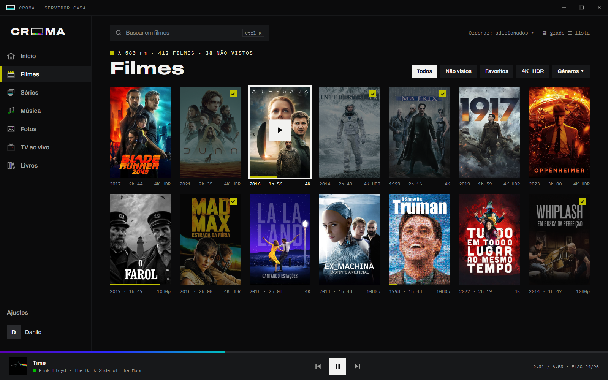

- Barra de título própria, escura, com o símbolo e o nome do servidor.
- Barra lateral com ícone e nome de cada biblioteca. A ativa ganha a barra vertical da cor.
- Busca com atalho `Ctrl K`. Grade e lista podem ser alternadas.
- Ao passar o mouse sobre um pôster, aparecem a borda de 4 px e o botão de assistir.
- **Mini player** fixo embaixo quando há música tocando, com o progresso em espectro.

### Mobile

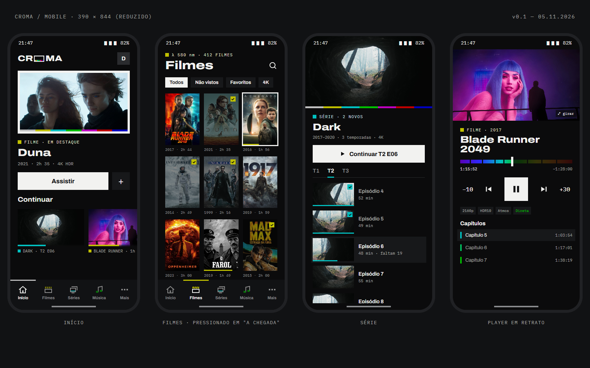

- Abas embaixo, com ícone e rótulo. A ativa tem a barra da cor em cima.
- **Série:** o backdrop ocupa a largura toda, abaixo da barra de status. Depois vêm as abas de temporada e a lista de episódios.
- **Música:** biblioteca com mini player acima das abas, página do álbum e tocando agora com analisador compacto (imagem 19).
- **Player em retrato:** vídeo no topo, controles grandes, linha do tempo em espectro e lista de capítulos. Ao girar, o player fica em tela cheia, igual ao da TV.

---

## 11. Voz e texto

- Fale como quem entende de imagem e som, sem jargão desnecessário. Em vez de "Erro de rede", escreva "O servidor Croma não responde".
- **Diga o que fazer:** "Confira se o computador está ligado e na mesma rede que a TV."
- **Números exatos:** "faltam 19 min", "11 de 26 vistos", "termina às 22:59".
- Bom humor só nos detalhes: "CANTO EM CHEIO", "SEM SINAL". Nunca em mensagens de erro que bloqueiam a pessoa.
- Português do Brasil, caixa de frase, sem ponto final em botões e rótulos.

---

## 12. Arquivos

| Pasta | Conteúdo |
|---|---|
| `logos/` | logotipo em curvas (4 versões), símbolo, símbolo mono, ícone do app |
| `logos/app/` | ícones exportados: `mobile/` (1024 a 120, Android adaptativo e mono), `desktop/` (`croma.ico` e PNG de 256 a 16), `tv/` (ícone Tizen 512 e tiles 16:9), `web/` (favicon e PWA) |
| `logos/icones/` | 8 ícones × 2 versões (cor e mono) |
| `fontes/` | código das pranchas (`.dc.html`), `support.js`, `canvas.json` e os geradores `gerar_icones.py`, `gerar_logotipo.py`, `gerar_icones_app.py` |
| `imagens/` | PNG das pranchas (01 a 39) |
| `midia/` | pôsteres e capas de exemplo (de terceiros, só para as pranchas) |

| Prancha | Arquivo | Imagem |
|---|---|---|
| Logo e símbolo | `Main.dc.html` | 01 |
| Cores e tipografia | `Paleta.dc.html` | 02 |
| Tela de calibração | `Calibracao.dc.html` | 03 |
| Início na TV | `InicioTV.dc.html` | 04 |
| Descanso de tela | `DescansoTela.dc.html` | 05, 06 |
| Sem sinal | `SemSinal.dc.html` | 07, 08 |
| Galeria de filmes (TV) | `GaleriaFilmes.dc.html` | 09 |
| Galeria de séries (TV) | `GaleriaSeries.dc.html` | 10 |
| Player (TV) | `Player.dc.html` | 11, 12 |
| Ícones das bibliotecas | `Icones.dc.html` | 13 |
| Plataformas | `Plataformas.dc.html` | 14 |
| Desktop | `Desktop.dc.html` | 15 |
| Mobile | `Mobile.dc.html` | 16 |
| Música: álbum (TV) | `MusicaTV.dc.html` | 17 |
| Música: tocando agora (TV) | `TocandoAgora.dc.html` | 18 |
| Música no mobile | `MusicaMobile.dc.html` | 19 |
| Música: galeria (TV) | `GaleriaMusica.dc.html` | 20 |
| Música: artista (TV) | `ArtistaTV.dc.html` | 21 |
| TV ao vivo: guia | `TVAoVivoGuia.dc.html` | 22 |
| TV ao vivo: canal | `TVAoVivoCanal.dc.html` | 23 |
| Fotos: galeria | `Fotos.dc.html` | 24 |
| Fotos: visualizador | `FotosVisualizador.dc.html` | 25 |
| Livros: galeria e capa gerada | `GaleriaLivros.dc.html` | 26 |
| Livros: leitor | `LeitorLivro.dc.html` | 27 |
| Detalhe do filme | `DetalheFilme.dc.html` | 28 |
| Detalhe do episódio | `DetalheEpisodio.dc.html` | 29 |
| Abertura | `Abertura.dc.html` | 30 |
| Perfis | `Perfis.dc.html` | 31 |
| Conectar ao servidor | `Servidor.dc.html` | 32 |
| Busca | `Busca.dc.html` | 33 |
| Ajustes | `Ajustes.dc.html` | 34 |
| Estados de interface | `Estados.dc.html` | 35 |
| Player: legendas e áudio | `PlayerMenus.dc.html` | 36 |
| Próximo episódio e pular abertura | `ProximoEpisodio.dc.html` | 37 |
| Player carregando | `PlayerCarregando.dc.html` | 38 |
| Arquivos oficiais | `Arquivos.dc.html` | 39 |

Para gerar uma imagem, abra o `.dc.html` no Edge headless (comando no `CLAUDE.md` do projeto). Use `--window-size=1920,1080` para as pranchas de TV e `1600,1000` para as demais.

---

## 13. Relação com a CAPRA

Em 05/11/2026, o usuário definiu a v0.1 "Barras" como a identidade oficial do Croma, **do jeito que está**. Com isso, o Croma deixa de seguir as regras de marca expressiva da CAPRA: linguagem maluma, paleta pastel, Inter e JetBrains Mono, foco em anel e endosso "por CAPRA".

A v0.2 (`../v0.2-capra/`) fica arquivada como referência.
