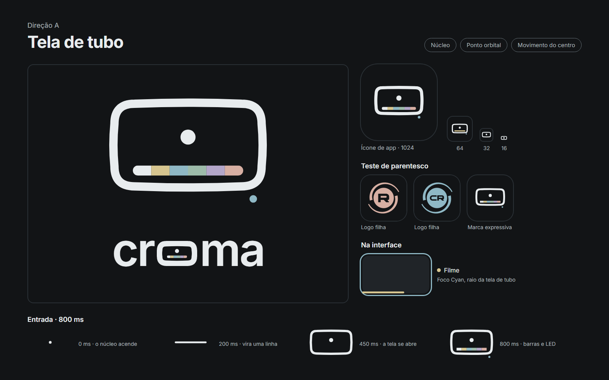
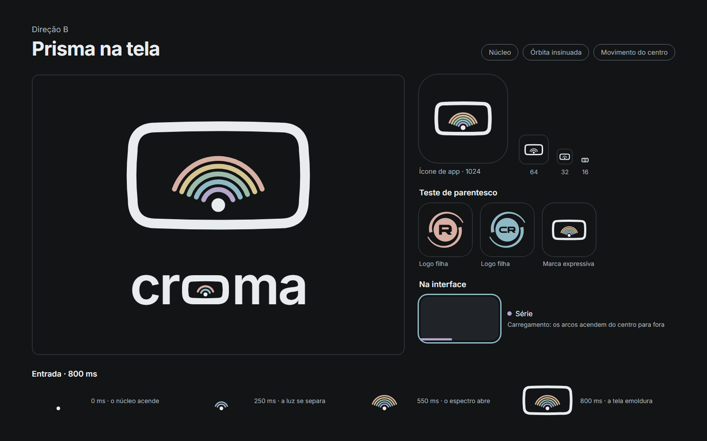
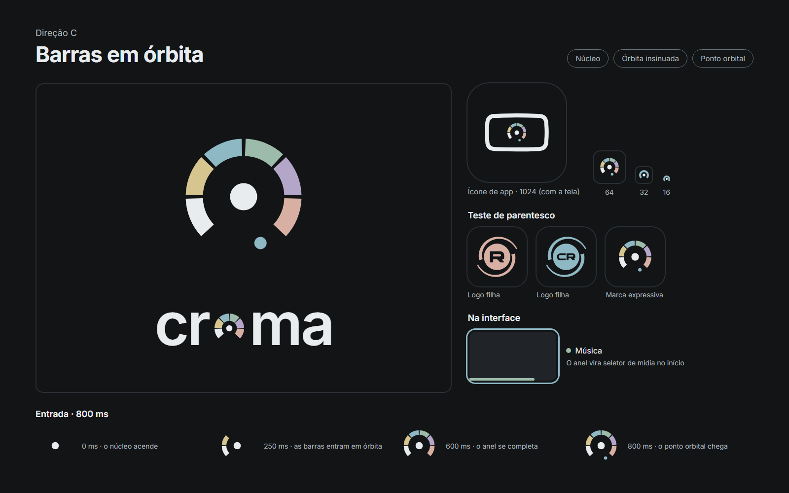

# Croma — Identidade visual v0.2 (marca expressiva CAPRA)

- **Status:** **arquivada** (05/11/2026). O usuário adotou a v0.1 "Barras" como identidade oficial (`../v0.1-barras/MANUAL.md`). Fica como referência.
- **Plano completo:** [`PLANO.md`](PLANO.md)
- **Canvas:** https://claude.ai/artifact/AUKTY2yvnHh4ZYk1c7qpLi, página "v0.2 Direções CAPRA" (privado)

As três direções seguem as regras da marca expressiva CAPRA:
- fundo `#121416`;
- Inter;
- só cores da paleta: Text `#E8ECEE`, Gold `#D6C58F`, Cyan `#8FB8C5`, Mint `#9DBBAA`, Lilac `#B3A6C9`, Peach `#D7AFA3`;
- linguagem maluma;
- sem brilho;
- pelo menos dois sinais sutis da CAPRA.

Cada prancha mostra:
- a marca e o logotipo "croma" com o "o" desenhado;
- o ícone de app (1024);
- os testes em 64, 32 e 16 px;
- o teste de parentesco, com as logos filhas Ravix e Croma (CR);
- um exemplo de foco na interface;
- a entrada animada (800 ms) em quatro quadros.

O teste de parentesco não inclui o logo CAPRA, porque o arquivo dele não está no repositório Capra.

## Direção A — Tela de tubo



- **Forma:**
  - tela de tubo 16:9 com cantos amplos e laterais levemente curvas;
  - núcleo de luz no centro;
  - faixa com as 6 barras pastel na base;
  - LED Cyan fora da tela.
- **Sinais CAPRA:** núcleo, ponto orbital (o LED) e movimento do centro.
- **Logotipo:** o "o" é uma mini-tela com núcleo e barras.
- **Entrada:** o núcleo acende, vira uma linha, a tela se abre, e as barras e o LED aparecem. É a TV de tubo ligando.
- **Pontos fortes:** é a mais fiel ao conceito (TV antiga e moldura horizontal). Lê bem em 64 px.
- **Pontos fracos:** em 32 e 16 px vira "tela com ponto", e as barras somem. O parentesco com a CAPRA depende só do núcleo e do LED.

## Direção B — Prisma na tela



- **Forma:** o núcleo, embaixo da tela, solta 5 arcos parciais (Lilac, Cyan, Mint, Gold, Peach). É a luz branca se separando em espectro.
- **Sinais CAPRA:** núcleo, órbita insinuada e movimento do centro.
- **Logotipo:** o "o" é uma mini-tela com núcleo e dois arcos.
- **Entrada:** o núcleo acende, os arcos abrem de dentro para fora e a tela emoldura.
- **Pontos fortes:** é a mais "espectrometria" e a mais próxima da gramática de arcos da CAPRA.
- **Pontos fracos:** na renderização, **lembra muito o ícone de Wi‑Fi** (arcos sobre um ponto), principalmente em 32 e 16 px. Também pode ser lida como arco-íris.

## Direção C — Barras em órbita



- **Forma:**
  - as 6 barras pastel curvadas num anel aberto (270°) em volta do núcleo;
  - ponto orbital Cyan na abertura;
  - a tela de tubo só aparece no ícone de app.
- **Sinais CAPRA:** núcleo, órbita insinuada e ponto orbital.
- **Logotipo:** o "o" é o próprio anel.
- **Entrada:** o núcleo acende, as barras entram em órbita uma a uma, e o ponto orbital chega.
- **Pontos fortes:** é a mais reconhecível em tamanho pequeno (anel com centro). O "o" é o encaixe mais natural no logotipo.
- **Pontos fracos:**
  - o anel aberto **lembra um velocímetro ou medidor**;
  - é a mais distante da ideia da moldura 16:9;
  - no logotipo, o "o" ficou pequeno e apertado.

## Comparação

| | A — Tela de tubo | B — Prisma na tela | C — Barras em órbita |
|---|---|---|---|
| Fidelidade ao conceito (TV antiga, moldura) | Alta | Média | Baixa |
| Parentesco com a CAPRA | Médio | Alto | Alto |
| Leitura em 16–32 px | Média | Baixa (parece Wi‑Fi) | Alta |
| Risco de confusão | Baixo | Wi‑Fi, arco-íris | Velocímetro |
| Logotipo | Bom ritmo, "o" largo | Bom ritmo, "o" largo | "o" natural, mas pequeno |

**Combinação possível:** a tela de tubo da A como forma principal (ícone e logotipo), com o anel da C como ícone reduzido e carregamento.

## Arquivos

| Pasta | Conteúdo |
|---|---|
| `imagens/` | PNG das três pranchas (1600×1000) |
| `direcoes/` | Código das pranchas (`Direcao*.dc.html`), `support.js` para abrir no navegador, e `assets/` com as logos filhas usadas no teste de parentesco |

Nas cópias locais, as logos filhas apontam para `assets/`. No canvas, elas são uploads do próprio canvas.

Para gerar as imagens de novo:

```sh
msedge --headless=new --window-size=1600,1000 --virtual-time-budget=8000 --screenshot=saida.png file:///<caminho>/direcoes/DirecaoA.dc.html
```
